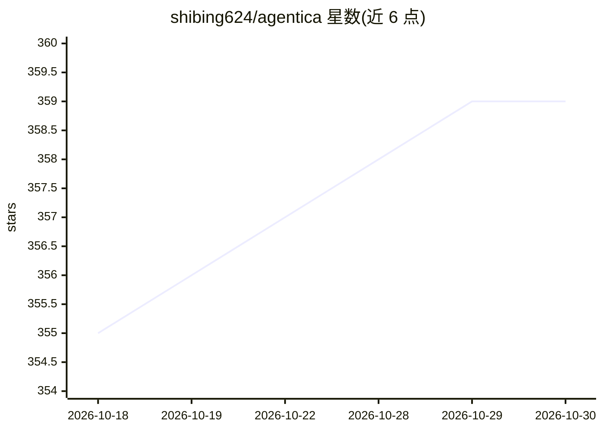

# shibing624/agentica

⭐ 359 · Python · Apache-2.0 · 推送 2026-10-29 · [GitHub](https://github.com/shibing624/agentica) · [官网](https://shibing624.github.io/agentica/) · 个人维护 · 中文 README

**多终端 AI Agent 框架：CLI/Web/桌面 + Python SDK，支持多会话协作与技能自进化**

跑在本机机器上的 agent 框架，提供 CLI、Web 网关、桌面 App 与 Python/TypeScript SDK 四种入口，共享同一套状态。多模型接入（OpenAI/DeepSeek/Claude/智谱/Ollama 等）。多会话协作含进程内 task、进程级 delegate 与跨终端 peer 消息。机制上：上下文压缩全程零 LLM 摘要、原文留在 session JSONL 可检索；持久化记忆；经验自动编译为可复用 SKILL.md。安装经 uv/pip，桌面版当前构建未签名。Apache 2.0。

## 筛选速览

| 维度 | 判定 | 备注 |
|---|---|---|
| AI 角色 | `ai-ecosystem` | LLM/agent 周边工具 |
| 许可风险 | `permissive` | Apache-2.0 |
| 部署形态 | `desktop` | 安装包/桌面程序 |
| 模型依赖 | local-ok | 支持本地模型 |
| 硬件要求 | — | 无带数字的原话,不猜 |
| 安装摩擦 | `low` | 无编译、无系统依赖或容器化 |
| 成熟度 | — | 结构信号不足 |

## 能力要点

- CLI/Web/桌面/SDK 四入口共享同一状态（~/.agentica）
- 零 LLM 摘要的上下文压缩，原文留在 session JSONL 可 search_session 取回
- task/delegate/peer 三种多会话协作机制
- 经验自动编译为跨会话复用的 SKILL.md，含 MCP/ACP、RAG 与 Guardrails

## 适用场景

- 在终端与本机网页里用多会话 agent 协作完成编码和数据分析任务
- 通过微信/企微/飞书/Telegram 远程指挥本机上的 agent 会话
- 用 Python SDK 将 agent 嵌入自己的代码与工作流
- 长期任务中保留可回溯的完整会话历史与持久记忆

## 场景标签

`Agent 框架` `多智能体` · 领域:Agent 开发

## 证据(README 行号)

> L7:  一个人，一支 agent 团队。 CLI 终端、本机 Web、Desktop App 是同一套产品，跑在你自己的机器上。
> L191: ## 功能特性
> L209: - **多智能体** — SDK：`Agent.as_tool()`、Workflow、Swarm、Markdown Subagent；CLI：`task` / `delegate` / peer 消息（见 终端文档）

## 星数曲线

2026-10-18 355 → 2026-10-30 359（+4）

---
*卡片 v1 · prompt 1.4 · 生成 2026-10-21 · 置信度 high · 依据 README sha `ab8b2a1b1261` · [字段定义](../../DATASET.md)*
