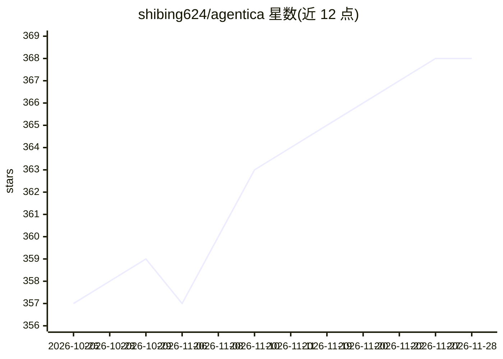

# shibing624/agentica

⭐ 368 · Python · Apache-2.0 · 推送 2026-11-27 · [GitHub](https://github.com/shibing624/agentica) · [官网](https://shibing624.github.io/agentica/) · 个人维护 · 中文 README

**个人多端 AI Agent 工作台：多会话协作、持久记忆与技能自进化**

以多种形态提供的 AI Agent 框架与工作台：桌面应用（macOS/Windows/Linux）、CLI 终端、本地 Web、IM（微信/飞书/Telegram 等）远程接入，以及 Python 与 TypeScript SDK 用于嵌入自建服务。核心机制包括子任务派生与后台进程、长期记忆自动记录、经验沉淀为可复用 Skill、上下文满窗时的换窗与压缩策略。数据与记忆存于本地。对多家模型厂商适配，会话内可切换模型，Apache 2.0 协议。

## 筛选速览

| 维度 | 判定 | 备注 |
|---|---|---|
| AI 角色 | `ai-ecosystem` | LLM/agent 周边工具 |
| 许可风险 | `permissive` | Apache-2.0 |
| 部署形态 | `library` | 以包/库形式分发 |
| 模型依赖 | local-ok | 支持本地模型 |
| 硬件要求 | — | 无带数字的原话,不猜 |
| 安装摩擦 | `low` | 无编译、无系统依赖或容器化 |
| 成熟度 | — | 结构信号不足 |

## 能力要点

- Desktop/CLI/Web/IM 多端共用本地记忆、技能与会话记录
- 子任务派生、后台执行与 Worktree 分支隔离的多会话协作
- 长期记忆自动记录与经验沉淀为可复用 Skill
- Python SDK (agentica) 与 npm (@agentica-ai/sdk) 二次开发

## 适用场景

- 在终端和桌面端用多个 Agent 并行处理编码任务
- 通过手机微信远程查看和指挥电脑上运行的任务
- 在自己的 Python/Node 服务中嵌入 Agent 能力

## 场景标签

`Agent 框架` `Agent 记忆` `多智能体` · 领域:Agent 开发

## 证据(README 行号)

> L7:  跑在你自己电脑上的全能 AI 工作台。 桌面端、CLI 终端、本地网页、手机微信随时开干，记忆与技能越用越熟 —— 同时提供 Python & TypeScript SDK。
> L34: |**🐍 Python SDK & 📦 npm SDK**|把 Agent 嵌入你自己的 Python 服务或 Node / TypeScript 应用|Python 5 分钟上手 · TypeScript SDK (`@agen
> L126: 软件本身。同一套 agent harness，既是本机工作台（Desktop、CLI、Web、IM），也是可嵌入线上服务的 Python 与 TypeScript SDK：

## 星数曲线

2026-10-26 357 → 2026-11-28 368（+11）

---
*卡片 v1 · prompt 1.4 · 生成 2026-11-28 · 置信度 high · 依据 README sha `36a3044fa464` · [字段定义](../../DATASET.md)*
