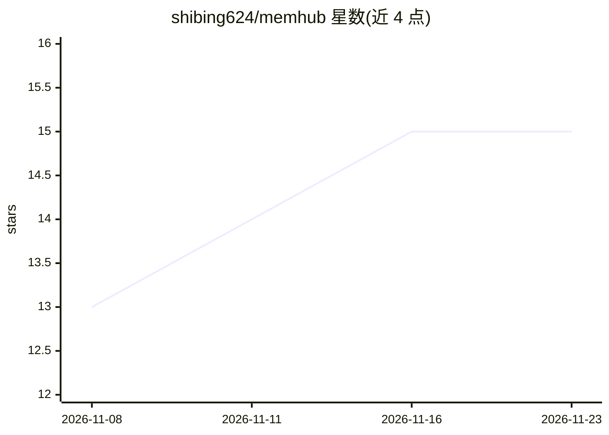

# shibing624/memhub

⭐ 15 · Python · Apache-2.0 · 推送 2026-11-22 · [GitHub](https://github.com/shibing624/memhub) · [官网](https://shibing624.github.io/memhub/) · 个人维护 · 中文 README

**跨 18 种 AI 编码工具共享的本地个人记忆中枢与 Python SDK**

本地优先的记忆服务与 Python SDK：为 Claude Code、Codex、Cursor 等 18 种宿主工具维护同一份长期记忆，支持历史会话扫描导入、提问前自动召回注入、MCP 主动查询。核心机制为版本演化记忆（写入裁决模型归档旧说法、启用新结论）与本机混合检索（约 0.17s，断网可用）。多设备通过私有 Git/网盘目录/SSH 同步增量变更，接收端不重算向量。运行需配置 LLM 与向量模型 API key（兼容 OpenAI 类网关）。

## 筛选速览

| 维度 | 判定 | 备注 |
|---|---|---|
| AI 角色 | `ai-ecosystem` | LLM/agent 周边工具 |
| 许可风险 | `permissive` | Apache-2.0 |
| 部署形态 | `library` | 以包/库形式分发 |
| 模型依赖 | — | README 未给出锁定关系 |
| 硬件要求 | — | 无带数字的原话,不猜 |
| 安装摩擦 | `low` | 无编译、无系统依赖或容器化 |
| 成熟度 | — | 结构信号不足 |

## 能力要点

- 版本演化记忆：新结论自动替代旧说法并保留历史链
- memhub scan 一键导入 18 种工具的历史会话
- 本机混合检索约 0.17s，断网可用，零账号零遥测
- 提供 Python SDK、MCP 服务与多租户 REST API 三种接入方式

## 适用场景

- 在 Cursor 定的项目规范换到 Claude Code 后无需重讲
- 把排障经验沉淀为症状→根因→关联文件，跨工具复用
- 多台电脑通过私有 Git 仓库同步记忆，不经云端服务

## 场景标签

`Agent 记忆` · 领域:Agent 开发

## 证据(README 行号)

> L7:  跨 18 种 AI 工具共享的本地个人记忆中枢 &amp; Python 记忆 SDK
> L111: 核心记忆引擎可作为独立 Python SDK、MCP 服务或多租户 REST API 嵌入自有 Agent 与应用：
> L125: 首次运行会在 `~/.memhub/config.yaml` 生成配置模板，填入任意 OpenAI 兼容模型与网关即可：

## 星数曲线

2026-11-08 13 → 2026-11-23 15（+2）

---
*卡片 v1 · prompt 1.4 · 生成 2026-11-18 · 置信度 high · 依据 README sha `70581126a0e0` · [字段定义](../../DATASET.md)*
