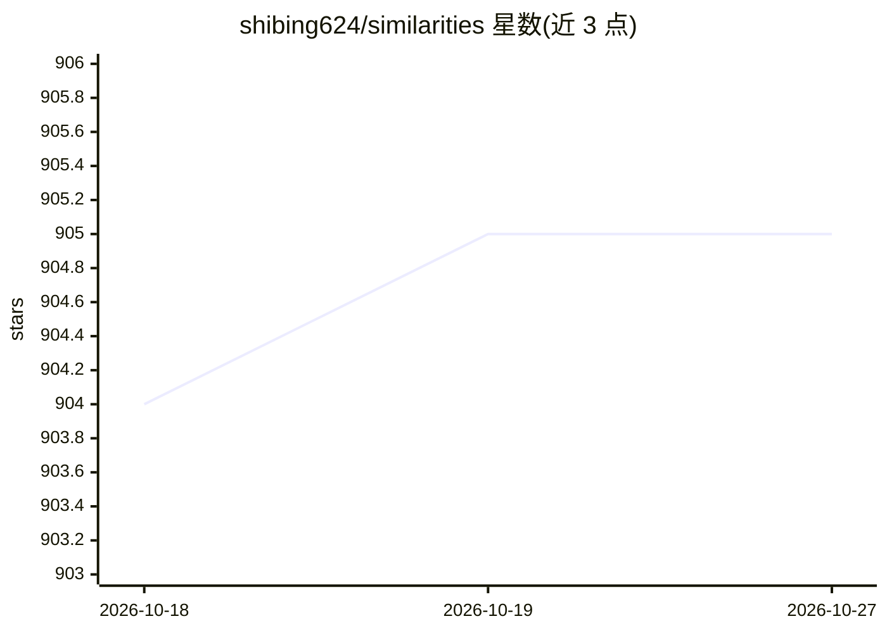

# shibing624/similarities

⭐ 905 · Python · Apache-2.0 · 推送 2026-03-05 · [GitHub](https://github.com/shibing624/similarities) · [官网](https://pypi.org/project/similarities/) · 个人维护 · 中文 README

**文本/图像相似度计算与语义搜索 Python 工具包**

基于 Python3 的相似度计算与语义匹配检索工具包：文本侧基于 text2vec 提供 CoSENT/SentenceBERT 类语义匹配，兼容 BM25、TFIDF、SimHash 等字面匹配算法；图像侧基于 PyTorch 实现 CLIP 图文检索，另提供 pHash/SIFT 等传统特征算法。支持 Faiss/Annoy/Hnsw 索引、亿级数据检索、GPU 加速、多卡命令行转向量与建索引，可启动 FastAPI 服务并配 Gradio 前端，面向开发与科研用户。

## 筛选速览

| 维度 | 判定 | 备注 |
|---|---|---|
| AI 角色 | `ai-native` | 本体是模型或模型工具 |
| 许可风险 | `permissive` | Apache-2.0 |
| 部署形态 | `library` | 以包/库形式分发 |
| 模型依赖 | — | README 未给出锁定关系 |
| 硬件要求 | — | 无带数字的原话,不猜 |
| 安装摩擦 | `low` | 无编译、无系统依赖或容器化 |
| 成熟度 | — | 结构信号不足 |

## 能力要点

- 文本/图像相似度计算与文搜文、文搜图、图搜图检索
- 支持 CoSENT/SentenceBERT 语义模型与 BM25/TFIDF/SimHash 字面匹配
- Faiss/Annoy/Hnsw 多种索引，支持亿级数据与 GPU 加速
- CLI 批量转向量、建索引、检索、启动服务

## 适用场景

- 问答系统中做问句相似匹配与文本搜索
- 搭建图搜图、文搜图的以图搜图服务
- 大规模图文数据语义去重与同义句挖掘

## 场景标签

`语义搜索` · 领域:知识与检索

## 证据(README 行号)

> L16: **similarities**: a toolkit for similarity calculation and semantic search, supports text and image. 相似度计算、语义匹配搜索工具
> L28: - 语义匹配模型【推荐】：本项目基于text2vec实现了CoSENT模型的文本相似度计算和文本搜索
> L37: - CLIP(Contrastive Language-Image Pre-Training)模型：图文匹配模型，可用于图文特征（embeddings）、相似度计算、图文检索、零样本图片分类，本项目基于PyTorch实现了CLIP

## 星数曲线

2026-10-18 904 → 2026-10-27 905（+1）

---
*卡片 v1 · prompt 1.4 · 生成 2026-10-21 · 置信度 high · 依据 README sha `f3c9807f036c` · [字段定义](../../DATASET.md)*
