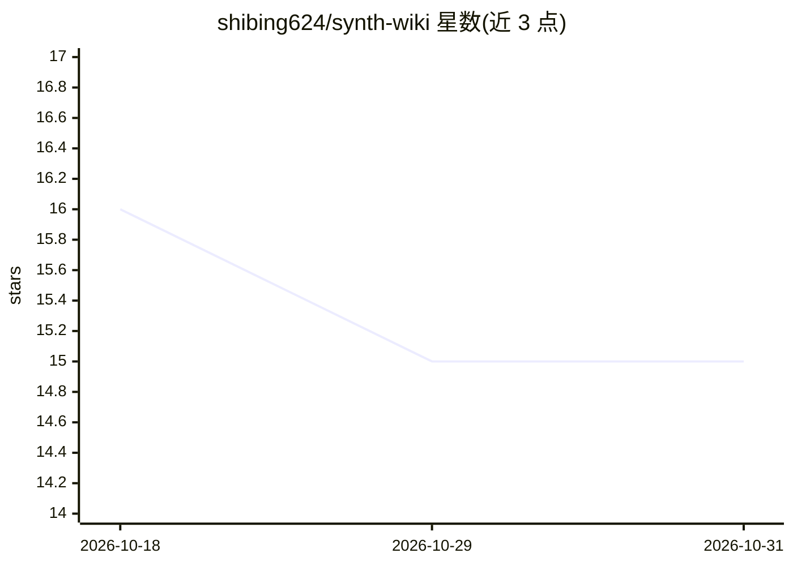

# shibing624/synth-wiki

⭐ 15 · Python · Apache-2.0 · 推送 2026-04-13 · [GitHub](https://github.com/shibing624/synth-wiki) · [官网](https://pypi.org/project/synth-wiki/) · 个人维护 · 中文 README

**将论文/笔记编译为互联可搜索个人 wiki 知识库的 CLI 工具**

Python 实现的命令行工具：把 Markdown/PDF/DOCX/代码等源文件放入目录，由 LLM 读取、总结、抽取概念并写成互联 wiki 文章，自动构建存于 SQLite 的实体-关系知识图（7 种关系类型、环检测）。搜索采用 TreeSearch 自动模式（Best-First 树遍历+FTS5）与可选向量检索经 RRF 融合，集成 Jieba 支持中文检索；无 embedder 时仅用 TreeSearch。支持 openai/anthropic/gemini/ollama 等 provider，可编译断点续传、watch 模式、lint 质量检查及 MCP server 供 IDE/agent 接入。

## 筛选速览

| 维度 | 判定 | 备注 |
|---|---|---|
| AI 角色 | `ai-native` | 本体是模型或模型工具 |
| 许可风险 | `permissive` | Apache-2.0 |
| 部署形态 | `library` | 以包/库形式分发 |
| 模型依赖 | local-ok | 支持本地模型 |
| 硬件要求 | — | 无带数字的原话,不猜 |
| 安装摩擦 | `low` | 无编译、无系统依赖或容器化 |
| 成熟度 | — | 结构信号不足 |

## 能力要点

- LLM 编译源文件为互联 wiki 文章并抽取概念
- 自动构建实体-关系知识图（SQLite 存储、类型化边、环检测）
- TreeSearch 自动模式+可选向量检索经 RRF 融合，无需 embedding 也可用
- 支持 7 种源格式（MD/PDF/DOCX/JSON/代码/文本/图片）与 Jieba 中文检索

## 适用场景

- 把论文、文章、笔记整理成互联可搜索的个人 wiki
- 对个人知识库做自然语言问答并溯源引用
- 增量添加资料持续丰富已有 wiki 条目

## 场景标签

`知识库管理` `文档问答` · 领域:知识与检索

## 证据(README 行号)

> L17: Drop in your papers, articles, and notes. `synth-wiki` compiles them into a structured, interlinked wiki — with con
> L19: - **Your sources in, a wiki out.** Add documents to a folder. The LLM reads, summarizes, extracts concepts, and wri
> L22: - **Ask your wiki questions.** Enhanced structure-aware search powered by TreeSearch. Ask natural language question

## 星数曲线

2026-10-18 16 → 2026-10-31 15（-1）

---
*卡片 v1 · prompt 1.4 · 生成 2026-10-30 · 置信度 high · 依据 README sha `e98831583149` · [字段定义](../../DATASET.md)*
