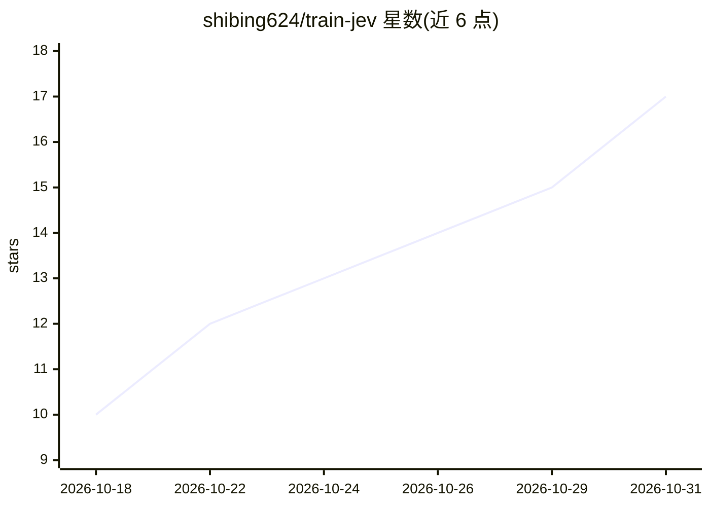

# shibing624/train-jev

⭐ 17 · Python · Apache-2.0 · 推送 2026-10-23 · [GitHub](https://github.com/shibing624/train-jev) · [官网](https://huggingface.co/shibing624) · 个人维护 · 中文 README

**在 Qwen 上训练并部署输出选项概率的决策模型**

基于 Qwen3.5/3.8 底座的 JEV 式 System 1 决策模型训练与部署工具链：LoRA + 24 槽位决策头，经 KL 蒸馏、金标监督与规则数据训练，一次前向输出各选项的校准概率而非生成文本；支持是非、选择、打分三种题型与图片输入，服务接口兼容 TypeSafe System One API。提供 4B/27B 两个已发布 LoRA 模型，也支持用自己的 JSONL 数据训练业务模型，含多卡 DDP/FSDP2 与断点续训。限制：27B 需约 54GB 显存（80GB 卡），Qwen3.5 需装 flash-linear-attention 加速。

## 筛选速览

| 维度 | 判定 | 备注 |
|---|---|---|
| AI 角色 | `ai-native` | 本体是模型或模型工具 |
| 许可风险 | `permissive` | Apache-2.0 |
| 部署形态 | `library` | 以包/库形式分发 |
| 模型依赖 | — | README 未给出锁定关系 |
| 硬件要求 | `gpu-8g` | |
| 安装摩擦 | `medium` | 含编译或系统依赖之一 |
| 成熟度 | — | 结构信号不足 |

## 能力要点

- LoRA + 24 槽位决策头，一次前向输出各选项校准概率
- 服务接口兼容 TypeSafe System One API（POST /v1/systemone）
- KL 蒸馏 + 金标监督 + 规则数据回放的完整训练链路，可混入自有数据
- 支持是非/选择/打分三题型及图片输入，附带按题型拟合的温度校准

## 适用场景

- 用工单等文本直接路由决策，高置信自动处理、低置信转人工
- 训练自己业务领域的决策模型并部署为 API 服务
- 在调 Jev 的代码中替换地址接入自部署模型

## 场景标签

`微调` · 领域:训练与推理

## 证据(README 行号)

> L13: **train-jev** 是一套自己训练、自己部署的 JEV 式 System 1 决策模型：一次前向，给出校准过的概率。
> L16: 模型不生成文本，而是给出每个选项的概率：置信度高的交给代码自动处理，剩下的转人工。

## 星数曲线

2026-10-18 10 → 2026-10-31 17（+7）

---
*卡片 v1 · prompt 1.4 · 生成 2026-10-30 · 置信度 mid · 依据 README sha `d669807cc283` · [字段定义](../../DATASET.md)*
