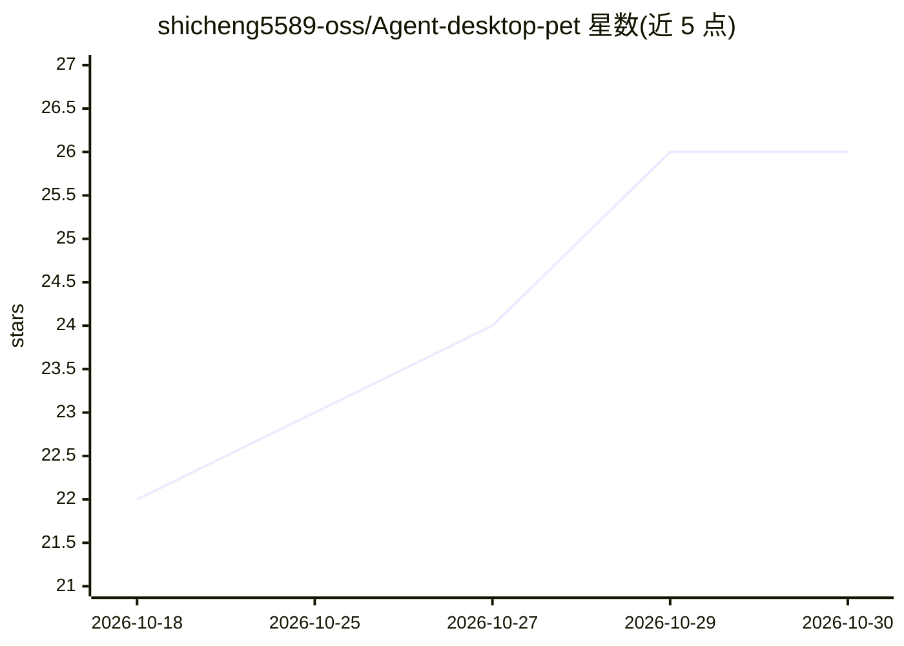

# shicheng5589-oss/Agent-desktop-pet

⭐ 26 · Python · NOASSERTION · 推送 2026-10-25 · [GitHub](https://github.com/shicheng5589-oss/Agent-desktop-pet) · 个人维护 · 中文 README

**跟随 12 个 AI Agent 实时状态换表情的 Windows Live2D 桌宠**

基于 Win32 分层窗口 + WebView2 的 Windows 桌面宠物：只读解析 Codex、Claude Code CLI、Gemini CLI、DeepSeek Harness 等 12 个 Agent 写在本机的会话记录（JSONL/SQLite），翻译成思考中/执行中/等待你等 9 个状态并映射到 40+ 个 Live2D 表情，配任务进度卡片显示任务名、工具调用数与上下文用量。记录格式无法解析时可用状态桥脚本补充状态。全程只读、不联网；仅支持 Windows 10 1809+/11，需 64 位 CPython 3.12 与 WebView2 Runtime，Python 依赖已内置 vendor/，双击脚本启动。

## 筛选速览

| 维度 | 判定 | 备注 |
|---|---|---|
| AI 角色 | `ai-enhanced` | 去掉 AI 部分产品仍成立 |
| 许可风险 | `none` | NOASSERTION |
| 部署形态 | `desktop` | 安装包/桌面程序 |
| 模型依赖 | — | README 未给出锁定关系 |
| 硬件要求 | — | 无带数字的原话,不猜 |
| 安装摩擦 | `medium` | 含编译或系统依赖之一 |
| 成熟度 | — | 结构信号不足 |

## 能力要点

- 读取 12 个 Agent 的本地会话记录并翻译为 9 个状态表情
- 状态桥脚本可从 agent hook/插件注入状态与任务信息
- 进度卡片显示任务名、工具调用数、上下文与 token 用量
- 全程只读、不联网，SQLite 以只读模式打开，敏感字段跳过

## 适用场景

- 写代码时用桌宠一眼看到 Codex/Claude Code 的当前状态
- 给常用编程 Agent 配一个桌面陪伴形象和进度卡片
- 记录不足的 Agent 通过状态桥脚本接入状态显示

## 场景标签

 · 领域:桌面工具/Agent 可视化

## 证据(README 行号)

> L5: 一只贴在 Windows 桌面上的 Live2D 小桌宠：**它跟着 Codex（或你接入的其它 Agent）的实时状态换表情**——
> L10: > 状态来源是各 agent 写在本地会话记录里的数据（默认 Codex，可在设置里切换），**只读、不联网**。
> L21: * **状态跟着 Agent 走**：读 Codex 的本地会话记录（也可在设置里切换成接进来的其它 11 个 Agent），翻译成 9 个状态；每个状态可以单独指定表情。

## 星数曲线

2026-10-18 22 → 2026-10-30 26（+4）

---
*卡片 v1 · prompt 1.4 · 生成 2026-10-27 · 置信度 high · 依据 README sha `ee6c4cb0ca1d` · [字段定义](../../DATASET.md)*
