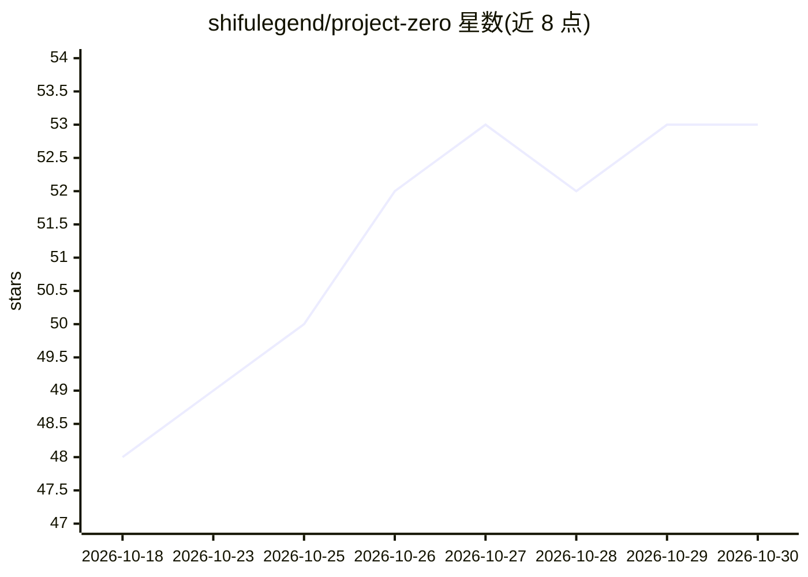

# shifulegend/project-zero

⭐ 53 · C · MIT · 推送 2026-10-25 · [GitHub](https://github.com/shifulegend/project-zero) · [官网](https://github.com/shifulegend/project-zero/discussions) · 个人维护

**纯 C 实现的 CPU LLM 推理引擎，单二进制运行多族模型**

面向开发者的本地 CPU 推理引擎：纯 C99 编写，make release 产出单可执行文件 pz，无需 Python、ML 框架或 GPU，预编译二进制仅依赖 libc/libm。支持 BitNet b1.58、Falcon3-1.58bit 三值模型、Bonsai Q2_0、稠密 GGUF、DeepSeek-V2 与 Qwen3 MoE、Mamba-1 等多族模型，单二进制切换无需按模型重编译。采用 AVX-512 VNNI/AVX-512/AVX2/标量的 ISA 分发（启动时 SIGILL 自检验证），README 列出与 bitnet.cpp、llama.cpp 在相同机器与提示下的逐线程基准数据及第三方 OpenBenchmarking 结果。已知限制：AVX2 主机上特定三值格式回退到标量路径（i5-8350U 约 0.1 tok/s）。

## 筛选速览

| 维度 | 判定 | 备注 |
|---|---|---|
| AI 角色 | `ai-ecosystem` | LLM/agent 周边工具 |
| 许可风险 | `permissive` | MIT |
| 部署形态 | `desktop` | 安装包/桌面程序 |
| 模型依赖 | locked-api |  |
| 硬件要求 | `cpu-ok` | |
| 安装摩擦 | `medium` | 含编译或系统依赖之一 |
| 成熟度 | — | 结构信号不足 |

## 能力要点

- 单二进制 pz 运行 BitNet b1.58、三值 GGUF、稠密 GGUF、DeepSeek-V2/Qwen3 MoE 等多族模型，无需按模型重编译
- 无第三方依赖，make release 单命令构建，运行仅依赖 libc/libm
- AVX-512 VNNI→AVX-512→AVX2→标量 ISA 分发，启动时执行验证而非信任 CPUID
- README 提供与 bitnet.cpp/llama.cpp 的同机同提示逐线程基准数据及第三方 OpenBenchmarking 复现结果

## 适用场景

- 在无 GPU 的笔记本/服务器上本地运行三值与 GGUF 模型
- 对比不同线程数与量化配置下的 CPU 推理吞吐
- 用单二进制在多族模型间切换而无需重编译

## 场景标签

`推理引擎` · 领域:训练与推理

## 证据(README 行号)

> L15: Pure C, single binary (`pz`). Runs Microsoft's BitNet b1.58 **5.4× faster than Microsoft's own `bitnet.cpp` at 4 th
> L17: - **No third-party dependencies** — `make release`, one executable; the prebuilt release binary needs only libc/lib
> L21: - **One binary, many model families** — BitNet b1.58 / Falcon3-1.58bit ternary, Bonsai Q2_0, dense GGUF, DeepSeek-V

## 星数曲线

2026-10-18 48 → 2026-10-30 53（+5）

---
*卡片 v1 · prompt 1.4 · 生成 2026-10-24 · 置信度 high · 依据 README sha `90d2afeb6ed8` · [字段定义](../../DATASET.md)*
