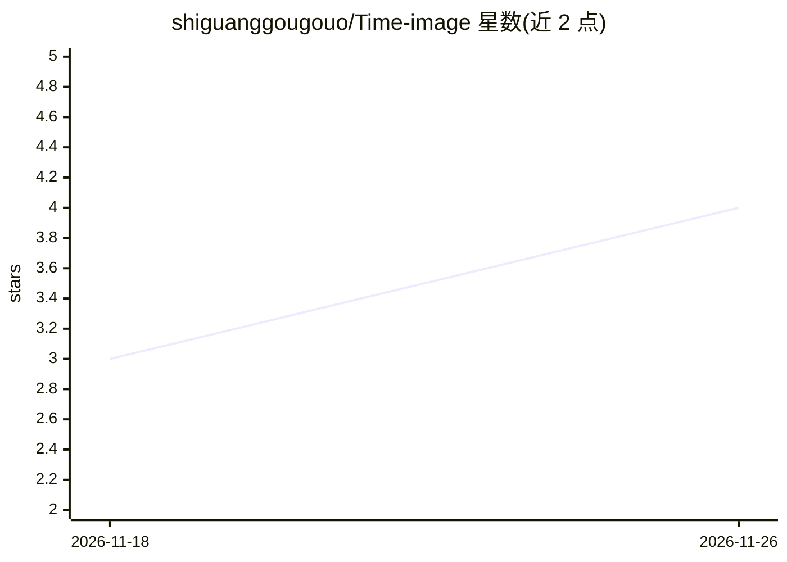

# shiguanggougouo/Time-image

⭐ 4 · JavaScript · NOASSERTION · 推送 2026-11-25 · [GitHub](https://github.com/shiguanggougouo/Time-image) · 个人维护 · 中文 README

**ComfyUI 的八个实用节点：提示词/尺寸、对齐、缓存、合成等**

Time image 是一组面向 ComfyUI 的八个自定义节点：提示词+参考图+分辨率组合节点、图像与遮罩按倍数对齐、等距柱状全景图交互查看与透视输出、工作流结束后的模型/执行缓存清理、AI 编辑图改动检测与局部合成回原图、完成提示音、GGUF UNET 加载器，以及画布文字标签。节点不下载模型权重，图像合成使用 OpenCV；通过 ComfyUI Manager、Git URL 或 comfy 命令安装，需重启 ComfyUI 生效。

## 筛选速览

| 维度 | 判定 | 备注 |
|---|---|---|
| AI 角色 | `ai-ecosystem` | LLM/agent 周边工具 |
| 许可风险 | `none` | NOASSERTION |
| 部署形态 | `None` |  |
| 模型依赖 | — | README 未给出锁定关系 |
| 硬件要求 | — | 无带数字的原话,不猜 |
| 安装摩擦 | `low` | 无编译、无系统依赖或容器化 |
| 成熟度 | — | 结构信号不足 |

## 能力要点

- 提示词+最多 10 张参考图+分辨率三合一节点，状态随工作流保存恢复
- 图像/遮罩对齐支持多种倍数、fit 模式与重采样方式
- 偏移修复节点自动进行特征配准、色彩匹配、改动检测与柔边合成
- 中英文双语界面，节点不下载模型或权重

## 适用场景

- 生成图像前统一管理提示词、参考图与目标尺寸
- 把已有图像和遮罩对齐到 SD/SDXL 等模型的尺寸倍数要求
- AI 编辑后只把改动合成回原图、保留背景
- 长工作流结束后清理显存与执行缓存

## 场景标签

`图像生成` `图像视频处理` · 领域:内容生成

## 证据(README 行号)

> L3: Time image 是一个包含 **八个 ComfyUI 节点** 的小套装，当前版本 **2.6.4**。下面按顺序介绍提示词、图像与分辨率节点、图像和遮罩对齐节点、全景图查看器、缓存清理器、偏移修复、完成提示音、专用 GGUF
> L16: 这些节点不需要下载模型或模型权重。图像合成器使用 OpenCV；当前 ComfyUI 环境已提供，无需另行安装。如果移植到没有 OpenCV 的环境，需要在该 ComfyUI 的 Python 环境安装 `opencv-pytho
> L20: 1. 在 ComfyUI Manager 中搜索 **Time image** 并安装；也可以用 **Install via Git URL** 填 `https://github.com/shiguanggougouo/Time

## 星数曲线

2026-11-18 3 → 2026-11-26 4（+1）

---
*卡片 v1 · prompt 1.4 · 生成 2026-11-26 · 置信度 high · 依据 README sha `3d9a16f84c62` · [字段定义](../../DATASET.md)*
