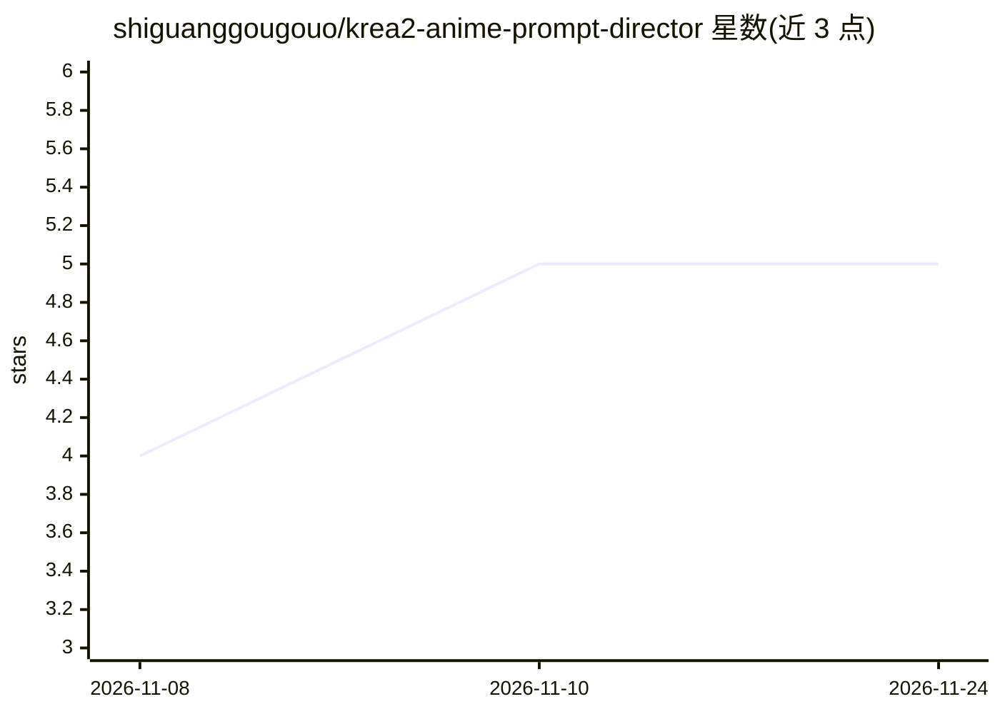

# shiguanggougouo/krea2-anime-prompt-director

⭐ 5 · MIT · 推送 2026-10-21 · [GitHub](https://github.com/shiguanggougouo/krea2-anime-prompt-director) · [官网](https://shiguanggougouo.github.io/krea2-anime-prompt-director/) · 个人维护 · 中文 README

**给 agent 用户把短想法扩写成完整 Krea 2 动漫提示词**

以 agent skill 形式分发的提示词生成技能：接收中英文短句输入，产出结构化的 POSITIVE/NEGATIVE 两段式 Krea 2 动漫绘图提示词，并附忠实中文翻译。核心机制包括：从可见特征锚定角色身份、把地名重建为可绘制的场景描述、自动从未指定场景中选取角色原作中的经典设定、在重复请求中变换场景与动作组合、对多角色交互进行动作分镜。包含 24 个真实运行案例图库与在线画廊，MIT 许可。

## 筛选速览

| 维度 | 判定 | 备注 |
|---|---|---|
| AI 角色 | `ai-native` | 本体是模型或模型工具 |
| 许可风险 | `permissive` | MIT |
| 部署形态 | `None` |  |
| 模型依赖 | — | README 未给出锁定关系 |
| 硬件要求 | — | 无带数字的原话,不猜 |
| 安装摩擦 | `low` | 无编译、无系统依赖或容器化 |
| 成熟度 | — | 结构信号不足 |

## 能力要点

- 中英文短句输入，输出 Krea 2 可用的完整动漫提示词及中文翻译
- 把专有名词场景重建为可绘制的物理布局描述
- 跟踪已用场景/动作对，重复请求时保持差异
- 基于两份 Krea 官方动漫指南与社区角色目录工作流

## 适用场景

- 为 Krea 2 生成动漫角色场景提示词
- 为同一角色生成不同场景与动作的变体提示词
- 纯场景（无角色）的动漫风格提示词扩写

## 场景标签

`提示工程` · 领域:Agent 开发

## 证据(README 行号)

> L13: A reusable agent skill that turns a short Chinese or English idea into a **complete, Krea 2-ready anime prompt** — 
> L31: Drop the whole folder into the skills directory your agent reads. Keep `SKILL.md` and `references/` together — the 

## 星数曲线

2026-11-08 4 → 2026-11-24 5（+1）

---
*卡片 v1 · prompt 1.4 · 生成 2026-11-21 · 置信度 high · 依据 README sha `5fa30e3f19f9` · [字段定义](../../DATASET.md)*
