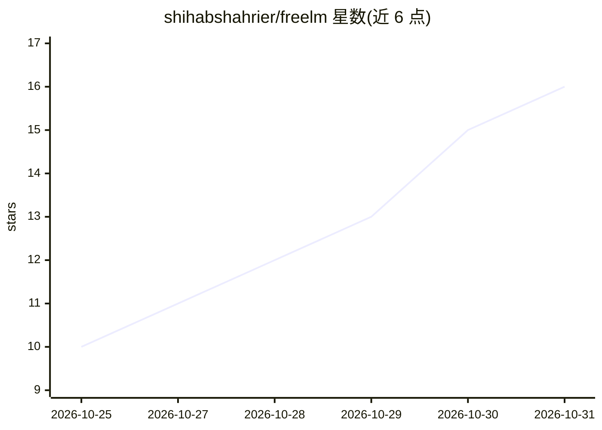

# shihabshahrier/freelm

⭐ 16 · Python · MIT · 推送 2026-10-10 · [GitHub](https://github.com/shihabshahrier/freelm) · [官网](https://shahriarlabs.com/products/freelm/) · 个人维护

**聚合各厂商免费 LLM 额度的 OpenAI 兼容库与本地网关**

面向 Python 与 Node.js 开发者的免费 LLM 路由库：把 Gemini、Groq、OpenRouter、Cloudflare Workers AI、Z.ai、Cohere、Mistral、NVIDIA NIM、Kilo 等的免费额度统一为一个 OpenAI 兼容客户端，或以 `freelm serve` 起本地 `/v1` 端点供任意工具使用。机制包括多 key 轮换、限流/故障/模型退役时跨厂商回退、慢提供方并行竞速、按实测延迟智能路由与配额守卫；CLI 无 key 时回退到无 key 公共端点。限制：免费额度与模型随时变动，部分厂商标记 beta 未实测。

## 筛选速览

| 维度 | 判定 | 备注 |
|---|---|---|
| AI 角色 | `ai-ecosystem` | LLM/agent 周边工具 |
| 许可风险 | `permissive` | MIT |
| 部署形态 | `self-host` | docker 或自建部署 |
| 模型依赖 | locked-api |  |
| 硬件要求 | — | 无带数字的原话,不猜 |
| 安装摩擦 | `low` | 无编译、无系统依赖或容器化 |
| 成熟度 | `idea` | |

## 能力要点

- 多厂商免费 LLM 聚合为单一 OpenAI 兼容客户端或本地 /v1 端点
- key 轮换、跨厂商回退与慢提供方并行竞速（约 6s 切换）
- freelm doctor 逐 key 检测可用性并给出修复指引
- CLI 无 key 可运行（回退 Kilo/OVHcloud 匿名端点）

## 适用场景

- 在代码或任意 OpenAI 兼容工具中零成本调用多家免费 LLM
- 用多个免费 key 做限流回退，保持调用不断线
- 本地起一个 /v1 网关接入 LangChain、Aider、Open WebUI 等工具

## 场景标签

`模型网关` · 领域:Agent 开发

## 证据(README 行号)

> L8: **freelm turns the free tiers of Google Gemini, Groq, OpenRouter, Cloudflare Workers AI, Z.ai, Cohere, Mistral,
> L10: A free-only, lightweight alternative to LiteLLM or an OpenRouter account: it rotates your keys, falls back across
> L51: `freelm serve` runs the same router as a local OpenAI-compatible API — streaming, tool calls and failover included:

## 星数曲线

2026-10-25 10 → 2026-10-31 16（+6）

---
*卡片 v1 · prompt 1.4 · 生成 2026-10-30 · 置信度 high · 依据 README sha `a36c7c62184a` · [字段定义](../../DATASET.md)*
