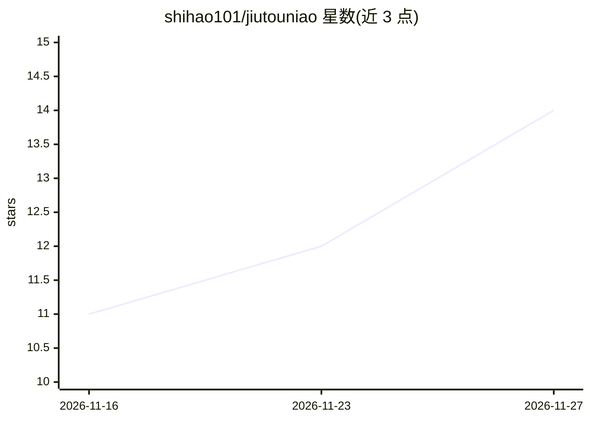

# shihao101/jiutouniao

⭐ 14 · Python · MIT · 推送 2026-11-25 · [GitHub](https://github.com/shihao101/jiutouniao) · 个人维护 · 中文 README

**面向授权渗透测试的多阶段 AI 智能体平台**

以 Go 引擎 + Vue 控制台构成的 AI 渗透测试平台：按 s1 资产到 s8 报告的八阶段专家头编排测试流程，内置 109 个中文攻击剧本技能库，接入 nmap/sqlmap/nuclei 等 Kali 工具链。治理机制包括强制授权范围与 ROE 核验、L0-L2 分级审批矩阵、破坏性命令直接拒绝、确定性证据校验门与 token 预算熔断。支持 OpenAI/Anthropic 双协议接入多模型，无 Key 时可用 Mock 演示模式。仅供书面授权测试使用。

## 筛选速览

| 维度 | 判定 | 备注 |
|---|---|---|
| AI 角色 | `ai-native` | 本体是模型或模型工具 |
| 许可风险 | `permissive` | MIT |
| 部署形态 | `self-host` | docker 或自建部署 |
| 模型依赖 | local-ok | 支持本地模型 |
| 硬件要求 | — | 无带数字的原话,不猜 |
| 安装摩擦 | `low` | 无编译、无系统依赖或容器化 |
| 成熟度 | — | 结构信号不足 |

## 能力要点

- 八阶段编排 + 三个专项头 + 主控头的多阶段智能体架构
- L0-L2 分级审批矩阵与 FORBIDDEN 命令直接拒绝的确定性治理门
- 109 个中文攻击剧本技能库按需 load_skill 注入
- 结论-证据硬校验、覆盖对账的零 LLM 成本反幻觉引擎

## 适用场景

- 在书面授权范围内自动化执行渗透测试全流程
- 高危利用动作需人工在 Web 界面审批后执行
- 生成带证据链的 SARIF/JSON 渗透测试报告
- 团队内按 ROE 约束管理红队测试操作

## 场景标签

`网络安全` `多智能体` · 领域:Agent 开发

## 证据(README 行号)

> L3: **通用型实战型 AI 渗透测试智能体平台**
> L5: An open-source, full-lifecycle AI agent platform for **authorized** penetration testing —
> L26: - **全流程编排**：s1 资产 → s2 侦察 → s3 威胁建模 → s4 漏洞发现 →（专项 A/B1/B2）→ s5 利用 → s6 后渗透（可选）→ s7 收尾 → s8 报告，阶段间自动回环直到拿下业务影响证明——八

## 星数曲线

2026-11-16 11 → 2026-11-27 14（+3）

---
*卡片 v1 · prompt 1.4 · 生成 2026-11-18 · 置信度 high · 依据 README sha `89c6a94e5a8f` · [字段定义](../../DATASET.md)*
