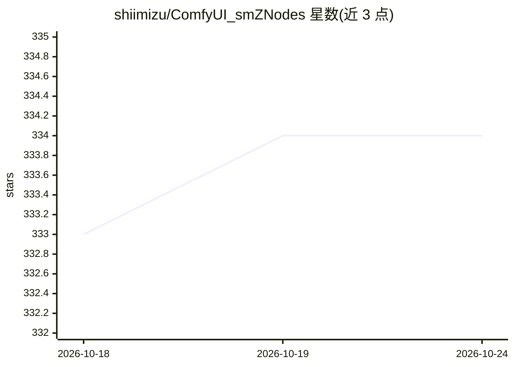

# shiimizu/ComfyUI_smZNodes

⭐ 334 · Python · GPL-3.0 · 推送 2026-10-12 · [GitHub](https://github.com/shiimizu/ComfyUI_smZNodes) · 个人维护

**ComfyUI 自定义节点：复现 stable-diffusion-webui 的提示词编码**

面向 ComfyUI 用户的自定义节点集，核心是 CLIP Text Encode++：采用 stable-diffusion-webui 的分词与编码管线（解析器来自 SD.Next），使相同提示词在两个 UI 中生成相同或相近的嵌入与图像。支持提示词编辑、AND/BREAK 关键字、权重归一化、多种 parser 选择；另含 Settings 动态节点用于采样/分词阶段微调。限制：LoRA 语法不支持，复杂提示词可能仍有差异。提供 ComfyUI Manager、git clone、手动下载三种安装方式。

## 筛选速览

| 维度 | 判定 | 备注 |
|---|---|---|
| AI 角色 | `ai-ecosystem` | LLM/agent 周边工具 |
| 许可风险 | `viral` | GPL-3.0 |
| 部署形态 | `None` |  |
| 模型依赖 | — | README 未给出锁定关系 |
| 硬件要求 | — | 无带数字的原话,不猜 |
| 安装摩擦 | `low` | 无编译、无系统依赖或容器化 |
| 成熟度 | — | 结构信号不足 |

## 能力要点

- 生成与 stable-diffusion-webui 一致的 CLIP 嵌入，复现同图
- 支持提示词编辑、AND/BREAK、权重归一化与 6 种 parser
- Settings 动态节点在采样/分词阶段微调参数

## 适用场景

- 从 stable-diffusion-webui 迁移到 ComfyUI 时复现既有出图
- 需要 A1111 风格提示词语法（权重/强调/交替词）的 ComfyUI 工作流
- 跨两个 UI 对比调试采样与编码行为

## 场景标签

`图像生成` · 领域:内容生成

## 证据(README 行号)

> L2: A selection of custom nodes for ComfyUI.
> L17: CLIP Text Encode++ can generate identical embeddings from stable-diffusion-webui for ComfyUI.

## 星数曲线

2026-10-18 333 → 2026-10-24 334（+1）

---
*卡片 v1 · prompt 1.4 · 生成 2026-10-21 · 置信度 high · 依据 README sha `70814915533b` · [字段定义](../../DATASET.md)*
