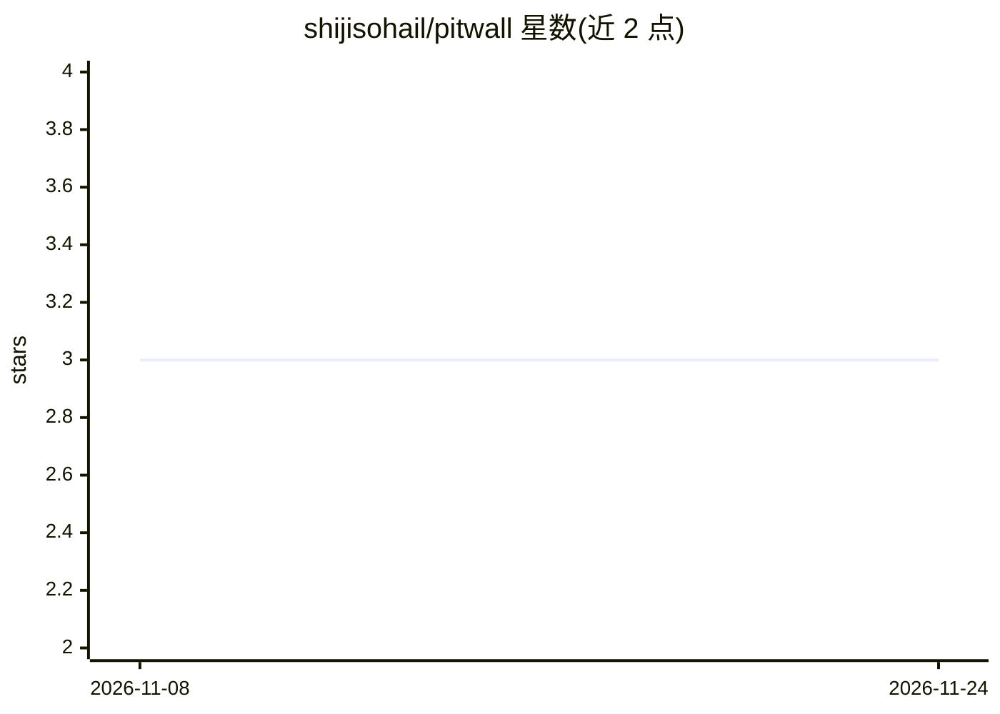

# shijisohail/pitwall

⭐ 3 · Swift · MIT · 推送 2026-11-19 · [GitHub](https://github.com/shijisohail/pitwall) · [官网](https://shijisohail.github.io/pitwall/) · 个人维护

**多会话管理 Claude Code 的原生 macOS 桌面 GUI**

一个 SwiftUI 编写的开源 macOS 桌面应用，为 Claude Code 提供图形前端：在标签页中并行运行多个会话，以卡片形式一键批准工具权限请求，实时查看文件改动 diff 并可回滚。它驱动用户已安装的 claude CLI（stream-json 协议），登录、技能、插件、MCP 配置沿用 CLI 本身，不自行实现，也无自有网络连接。提供 .dmg 安装包，也可用 Xcode 从源码构建；要求 macOS 26+ 和 Apple silicon 或 Intel。

## 筛选速览

| 维度 | 判定 | 备注 |
|---|---|---|
| AI 角色 | `ai-ecosystem` | LLM/agent 周边工具 |
| 许可风险 | `permissive` | MIT |
| 部署形态 | `desktop` | 安装包/桌面程序 |
| 模型依赖 | — | README 未给出锁定关系 |
| 硬件要求 | — | 无带数字的原话,不猜 |
| 安装摩擦 | `low` | 无编译、无系统依赖或容器化 |
| 成熟度 | — | 结构信号不足 |

## 能力要点

- 并行会话看板：Working / Needs you / Done today 三状态卡片，卡上直接 Allow/Always/Deny
- 实时 Changes diff（可一键回滚）、Plan、上下文用量与文件查看器
- 驱动用户自身 claude CLI，读写 ~/.claude 原生转录，无自有数据库与遥测
- 原生实现 /resume /permissions /fork 等 CLI 命令，git worktree 会话隔离

## 适用场景

- 同时跑多个 AI 编码会话，统一管理权限审批
- 图形化查看和回滚 Claude 对项目文件的改动
- 在同一项目用 git worktree 隔离并行 agent 避免冲突

## 场景标签

`编码 Agent` · 领域:编码与开发

## 证据(README 行号)

> L12:  A native macOS front end for Claude Code.
> L28: Pitwall is a free, open-source **Claude Code GUI for Mac**: a native desktop app (SwiftUI) that lets you run and su
> L136: Pitwall launches `claude -p --input-format stream-json --output-format stream-json` for each session and speaks it

## 星数曲线

2026-11-08 3 → 2026-11-24 3（+0）

---
*卡片 v1 · prompt 1.4 · 生成 2026-11-21 · 置信度 high · 依据 README sha `92cdb76dd156` · [字段定义](../../DATASET.md)*
