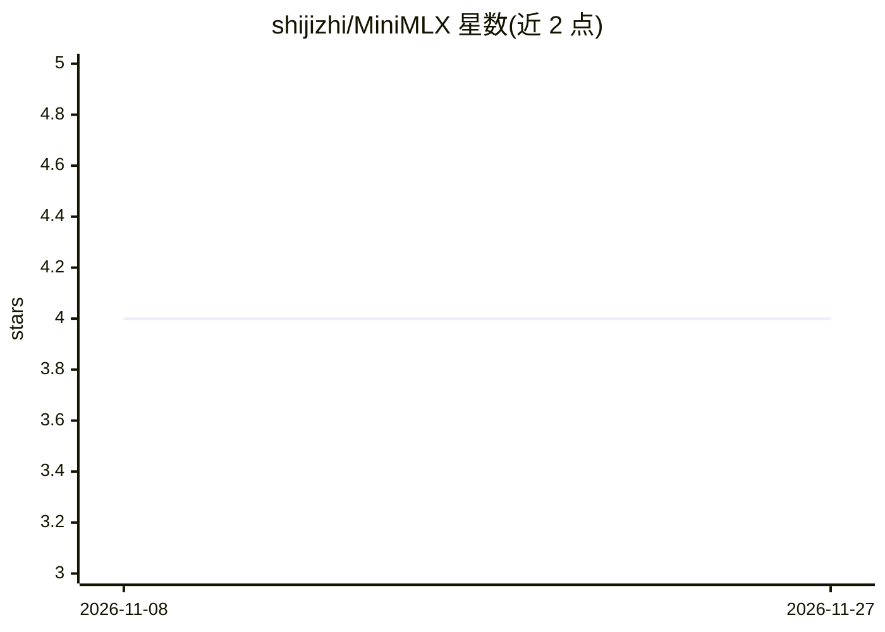

# shijizhi/MiniMLX

⭐ 4 · Python · Apache-2.0 · 推送 2026-11-25 · [GitHub](https://github.com/shijizhi/MiniMLX) · 组织维护 · 中文 README

**在 Apple Silicon Mac 上运行与服务 MLX 模型的原生应用**

MiniMLX 是一款原生 macOS 应用，将 MLX 格式模型的搜索下载、本地推理与 OpenAI 兼容 API 服务整合在同一界面中。用户可从 Hugging Face 与 ModelScope 搜索下载模型、添加本地已有模型目录、暂停/恢复下载，并一键启动本地推理服务供支持 OpenAI 兼容 API 的客户端连接。提供 MTP 加速、内置性能测试（吞吐/延迟/内存）与菜单栏控制。要求 Apple Silicon Mac，大模型需要较大内存与磁盘空间。

## 筛选速览

| 维度 | 判定 | 备注 |
|---|---|---|
| AI 角色 | `ai-ecosystem` | LLM/agent 周边工具 |
| 许可风险 | `permissive` | Apache-2.0 |
| 部署形态 | `None` |  |
| 模型依赖 | — | README 未给出锁定关系 |
| 硬件要求 | — | 无带数字的原话,不猜 |
| 安装摩擦 | `low` | 无编译、无系统依赖或容器化 |
| 成熟度 | `idea` | |

## 能力要点

- 从 Hugging Face 与 ModelScope 搜索、下载并管理 MLX 模型
- 一键启动本地推理服务，暴露 OpenAI 兼容 API（默认 127.0.0.1:18765/v1）
- 内置性能测试：prompt 处理、生成速度、延迟与内存占用并支持导出历史
- 兼容模型支持 MTP 加速与部分内存加载

## 适用场景

- 在 Mac 本地运行开源模型而无需命令行操作
- 为支持 OpenAI 兼容 API 的本地应用提供模型后端
- 对比不同模型在自己机器上的推理性能

## 场景标签

`推理引擎` · 领域:训练与推理

## 证据(README 行号)

> L22: A powerful model shouldn't come with a complicated setup. MiniMLX brings model downloads, local inference, and an A
> L57: Start a local inference service with a click and connect applications that support an **OpenAI-compatible API**. Mi

## 星数曲线

2026-11-08 4 → 2026-11-27 4（+0）

---
*卡片 v1 · prompt 1.4 · 生成 2026-11-21 · 置信度 high · 依据 README sha `d7ca6afc7fac` · [字段定义](../../DATASET.md)*
