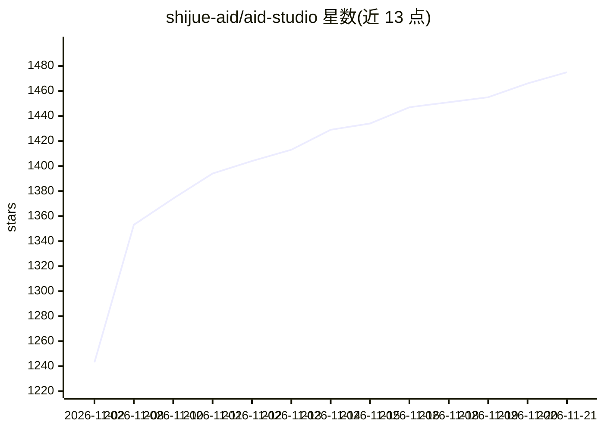

# shijue-aid/aid-studio

⭐ 1,475 · Java · MIT · 推送 2026-11-20 · [GitHub](https://github.com/shijue-aid/aid-studio) · [官网](https://www.aidstudio.com.cn/) · 组织维护 · 中文 README

**自托管的 AI 漫剧/短剧/电影与漫画创作平台**

开源（MIT）的 AI 动态漫画与短剧创作平台，覆盖剧本、分镜工作台、图片/视频生成、多音色配音到成片预览的端到端流程，也支持短片与静态漫画。面向创作者、团队与自部署开发者：通过统一 Providers 配置文本/图像/视频/语音模型与 API 网关，凭各厂商 API 凭证调用（调用与存储产生费用）。提供 Docker 与 systemd 两种部署模式、统一任务队列、计费与用户体系，含 aid-updater 在线升级与回滚。

## 筛选速览

| 维度 | 判定 | 备注 |
|---|---|---|
| AI 角色 | `ai-native` | 本体是模型或模型工具 |
| 许可风险 | `permissive` | MIT |
| 部署形态 | `self-host` | docker 或自建部署 |
| 模型依赖 | — | README 未给出锁定关系 |
| 硬件要求 | — | 无带数字的原话,不猜 |
| 安装摩擦 | `low` | 无编译、无系统依赖或容器化 |
| 成熟度 | — | 结构信号不足 |

## 能力要点

- 剧本/分镜/图像/视频/配音的端到端 AI 创作工作流与工作流画布
- 多模型接入：统一 Providers 配置文本、图像、视频、语音模型及 API 网关
- 统一任务系统：生成队列、并发调度、重试与补偿
- Docker 与 systemd 两种部署模式，支持在线升级与回滚（aid-updater）

## 适用场景

- 制作 AI 动态漫画或短剧剧集，从剧本到配音成片在一个项目内完成
- 团队自部署平台并配置自有模型与 API 凭证
- 创作 AI 短片或静态漫画，管理角色与场景资产保持视觉一致性

## 场景标签

`视频生成` `图像生成` `语音合成` · 领域:内容生成

## 证据(README 行号)

> L5: **AID Studio is an open-source AI motion comic creation platform for AI short dramas, films and comics, with an end-
> L43: - **Complete creative workflow**: Organize scripts, characters, scenes, storyboards, images, videos and voiceovers 
> L54: AID focuses on **AI motion comics and short dramas**, and also supports cinematic short films and static comics. Cr

## 星数曲线

2026-11-02 1,243 → 2026-11-21 1,475（+232）

---
*卡片 v1 · prompt 1.4 · 生成 2026-11-02 · 置信度 high · 依据 README sha `6d8b0adba427` · [字段定义](../../DATASET.md)*
