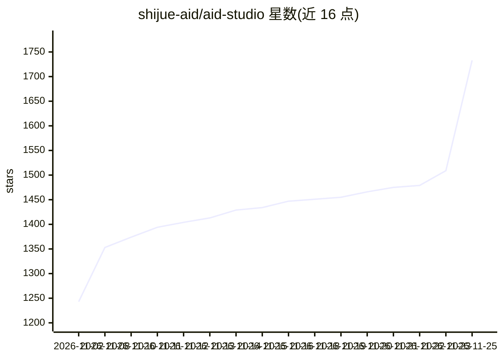

# shijue-aid/aid-studio

⭐ 1,733 · Java · MIT · 推送 2026-11-22 · [GitHub](https://github.com/shijue-aid/aid-studio) · [官网](https://www.aidstudio.com.cn/) · 组织维护 · 中文 README

**面向创作者的开源自托管 AI 漫剧/短剧/短片制作工作台**

可自托管的开源影视创作工作台，覆盖从剧本到成片的流程：撰写或导入剧本、准备角色与场景素材、按分镜生成视频、配音、音画同步与成片预览。提供无限画布（节点连线编排多媒体素材、多人协作）、导演台（机位、构图、运镜）、3D 预演台（白模、灯光、动作与时间轴回放录制）及管理后台（模型配置、计费、Agent/Skill/计算节点管理）。支持 Docker 与 systemd 部署，代码为 MIT 协议，模型调用与存储可能产生费用。

## 筛选速览

| 维度 | 判定 | 备注 |
|---|---|---|
| AI 角色 | `ai-native` | 本体是模型或模型工具 |
| 许可风险 | `permissive` | MIT |
| 部署形态 | `None` |  |
| 模型依赖 | — | README 未给出锁定关系 |
| 硬件要求 | — | 无带数字的原话,不猜 |
| 安装摩擦 | `medium` | 含编译或系统依赖之一 |
| 成熟度 | — | 结构信号不足 |

## 能力要点

- 剧本→分镜→视频→配音→成片的流程化创作
- 无限画布用节点连线编排文本/图片/视频/音频并支持协作
- 导演台与 3D 预演台支持机位、运镜与预演片段录制
- 管理后台可配置供应商、模型能力、计费与任务并发

## 适用场景

- 自托管搭建漫剧/短剧制作流水线
- 用画布节点管理多模态素材并团队协作
- 在 3D 预演台排布机位与灯光后生成成片

## 场景标签

`视频生成` · 领域:内容生成

## 证据(README 行号)

> L9: AID Studio 是可自托管的开源影视创作工作台，适合做漫剧、短剧和短片。
> L33: |**流程化创作**|撰写或导入剧本，准备角色和场景素材，按分镜生成视频，再配音、同步音画并预览成片。|
> L53: - **自行部署**：支持 Docker 和 systemd，后台可配置供应商、计费和任务并发。

## 星数曲线

2026-11-02 1,243 → 2026-11-25 1,733（+490）

---
*卡片 v1 · prompt 1.4 · 生成 2026-11-23 · 置信度 high · 依据 README sha `1d0521298efd` · [字段定义](../../DATASET.md)*
