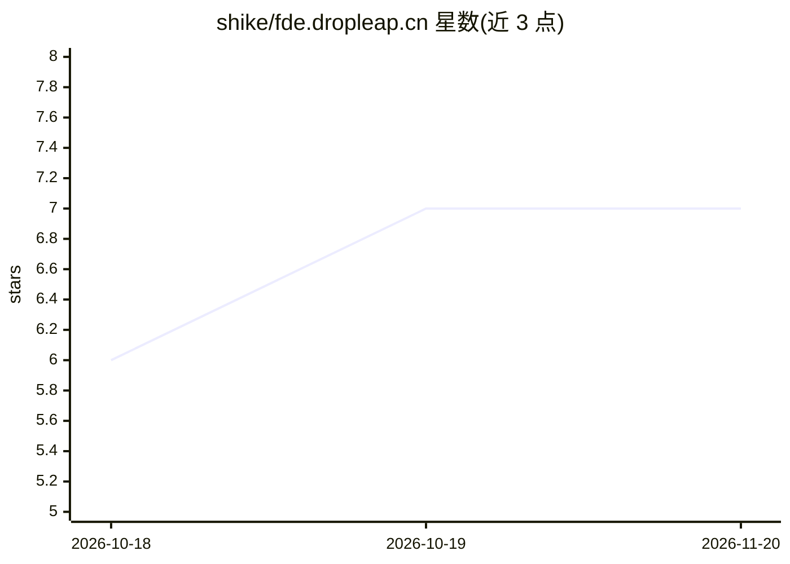

# shike/fde.dropleap.cn

⭐ — · [GitHub]() · 组织维护 · 中文 README

**面向中国 AI 落地从业者的 FDE 名录与行业资料库**

收录中国大陆 FDE（前置部署工程师）与 AI 落地从业者的在线名录，由人物、案例、公司、政策四个相互关联的库组成，附公开渠道证据链接并每日增量更新。收录采用严口径（驻场交付、亲手解决、对结果负责），不展示个人联系方式并提供更正/删除通道。技术栈为 Next.js 静态导出 + SQLite，Node 22 采集管道按日自动执行五步增量流程，产物可托管于任意 nginx 或对象存储。

## 筛选速览

| 维度 | 判定 | 备注 |
|---|---|---|
| AI 角色 | `ai-knowledge` | 知识聚合/清单类 |
| 许可风险 | `none` | — |
| 部署形态 | `None` |  |
| 模型依赖 | — | README 未给出锁定关系 |
| 硬件要求 | — | 无带数字的原话,不猜 |
| 安装摩擦 | `low` | 无编译、无系统依赖或容器化 |
| 成熟度 | — | 结构信号不足 |

## 能力要点

- 人物（5,500+）、案例（300+）、公司（140+）、政策（100+）四库联动
- 每日 5 点五步增量采集管道：发现→自述检测→信息加深→城市归一→政策采集
- SEO + GEO 就绪：SSR 预渲染 5,900+ 页面、sitemap、JSON-LD、llms.txt
- 合规内建：不展示个人联系方式，提供收录/更正/删除通道

## 适用场景

- 查找在中国大陆一线交付的 FDE 从业者与服务商
- 检索 AI 落地行业案例与公开报道
- 了解各地 AI 相关部委/城市/区县政策

## 场景标签

`精选清单` · 领域:学习与行业

## 证据(README 行号)

> L3: > 中国最权威的 Forward Deployed Engineer（前置部署工程师）名录
> L8: 交付服务商、行业案例与各地政策——四个库相互关联，条条附证据链接，每日更新。

## 星数曲线

2026-10-18 6 → 2026-11-20 7（+1）

---
*卡片 v1 · prompt 1.4 · 生成 2026-11-20 · 置信度 high · 依据 README sha `fbb8b8f30399` · [字段定义](../../DATASET.md)*
