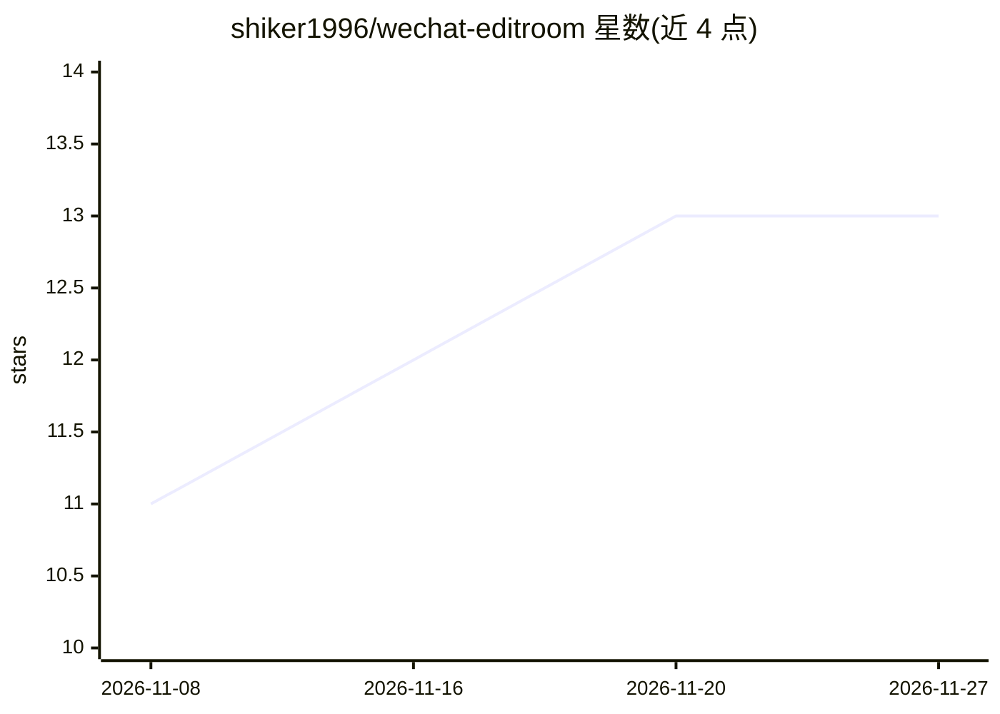

# shiker1996/wechat-editroom

⭐ 13 · JavaScript · MIT · 推送 2026-11-26 · [GitHub](https://github.com/shiker1996/wechat-editroom) · [官网](https://wechat-newsroom-guide.vercel.app/) · 个人维护 · 中文 README

**公众号作者的本地内容采集、编辑与排版工作台**

面向公众号作者与内容团队的本地优先桌面工作台，覆盖热点采集、热点打标与事件聚类、事实卡、选题、文章生产、审稿、公众号 HTML 排版、封面与小红书图文等环节，产物、版本与失败原因可回看。Windows 提供安装包且无需单独安装 Node.js；macOS/Linux 仅源码运行。AI 参与研判与生成，可选内置模型或通过 MCP 接入 Codex、WorkBuddy 等外部 Agent，编辑决策按阶段保存、关键节点可人工修改。

## 筛选速览

| 维度 | 判定 | 备注 |
|---|---|---|
| AI 角色 | `ai-enhanced` | 去掉 AI 部分产品仍成立 |
| 许可风险 | `permissive` | MIT |
| 部署形态 | `None` |  |
| 模型依赖 | — | README 未给出锁定关系 |
| 硬件要求 | — | 无带数字的原话,不猜 |
| 安装摩擦 | `low` | 无编译、无系统依赖或容器化 |
| 成熟度 | — | 结构信号不足 |

## 能力要点

- 热点采集→研判→选题→写稿→排版→交付的一体化流程
- 热点打标、事件聚类、事实卡等编辑判断分阶段保存可追溯
- 通过 MCP 与项目 Skills 接入 Codex、WorkBuddy 等本机 Agent 客户端
- 文章、图片、日志默认保存在本机的本地优先设计

## 适用场景

- 持续运营公众号，集中管理热点、来源与稿件
- 把文章、封面、小红书图文和排版流程统一在一个工作区
- 让外部 Agent 代为采集信息并调用本机排版与产物保存

## 场景标签

`AI 写作` `工作流自动化` `文档解析` · 领域:效率与自动化

## 证据(README 行号)

> L9: 如果你经常在浏览器、聊天记录和排版工具之间来回复制，见字可以把来源、编辑判断、文章和交付物放回同一张本地工作台：
> L37: 热点打标、事件聚类、事实卡、受众相关度和候选选题会分阶段保存。你可以知道一篇文章为什么被选中、依据了哪些来源，也可以在关键节点停下来修改方向。
> L43: ### 像桌面软件一样工作

## 星数曲线

2026-11-08 11 → 2026-11-27 13（+2）

---
*卡片 v1 · prompt 1.4 · 生成 2026-11-18 · 置信度 high · 依据 README sha `8a279346fb0a` · [字段定义](../../DATASET.md)*
