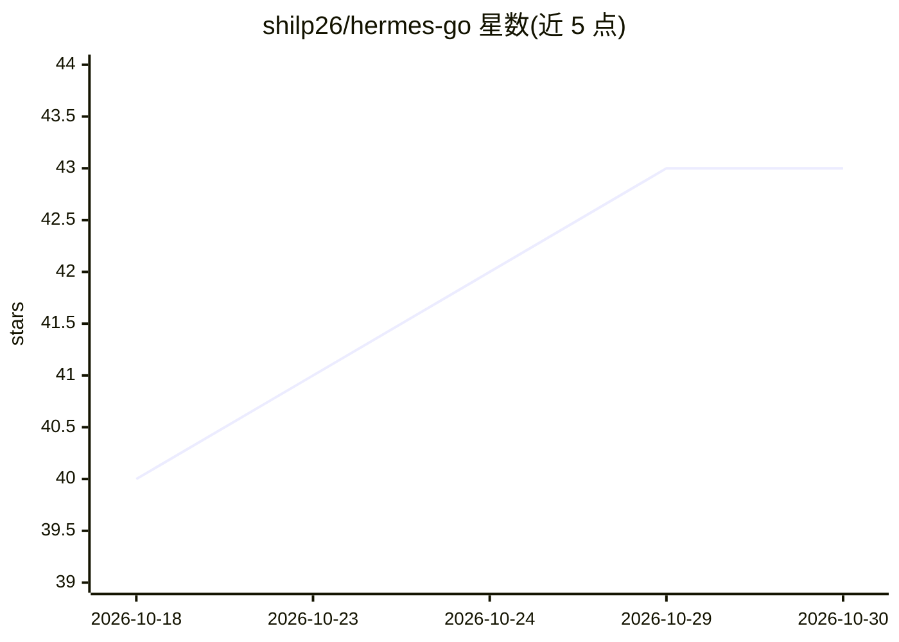

# shilp26/hermes-go

⭐ 43 · HTML · MIT · 推送 2026-10-18 · [GitHub](https://github.com/shilp26/hermes-go) · [官网](https://shilp26.github.io/hermes-go/) · 个人维护

**自托管 Hermes Agent 的原生 Android 移动客户端**

Android 原生应用，作为 Hermes Agent（自托管或 Hermes Cloud）的移动客户端：提供聊天流式输出与推理行、语音听写与朗读、审批/队列/中途转向控制、会话管理、Bots Mode 多 agent 协作、定时例程、artifacts 浏览、健康与日志监控等（自称 9 surfaces · 52 segments · 253 features）。自托管连接经 LAN、Tailscale 或 TLS 反代直连服务器，云端经 portal。闭源，仅通过 Google Play 分发，声明零遥测。

## 筛选速览

| 维度 | 判定 | 备注 |
|---|---|---|
| AI 角色 | `ai-ecosystem` | LLM/agent 周边工具 |
| 许可风险 | `permissive` | MIT |
| 部署形态 | `None` |  |
| 模型依赖 | — | README 未给出锁定关系 |
| 硬件要求 | — | 无带数字的原话,不猜 |
| 安装摩擦 | `low` | 无编译、无系统依赖或容器化 |
| 成熟度 | — | 结构信号不足 |

## 能力要点

- 自托管部署下一个提示完成 basic auth 配置、绑定 9119 端口并检测 Tailscale
- Bots Mode 提供命名 AI 队友、@ 指派、Bot Groups、多 agent 讨论室与执行共识蒸馏
- Hermes Live 后台保活：息屏下继续流式输出，通知带快捷回复与审批
- 声明零遥测，连接直连用户自己的服务器

## 适用场景

- 在手机上完整操控和监控自托管的 Hermes Agent
- 用 @ 指派让多个 AI 队友分工处理任务
- 在移动端审批 agent 操作、查看日志与健康状态

## 场景标签

`AI 助手` · 领域:对话与助手

## 证据(README 行号)

> L7: A native mobile client for your Hermes Agent. For self-hosted setups, one prompt configures basic auth, binds port 9
> L17: Hermes Go is a **native Android client** for Hermes Agent — self-hosted or Hermes Cloud. It is not a chat wrapper —

## 星数曲线

2026-10-18 40 → 2026-10-30 43（+3）

---
*卡片 v1 · prompt 1.4 · 生成 2026-10-25 · 置信度 high · 依据 README sha `4f50cc857f51` · [字段定义](../../DATASET.md)*
