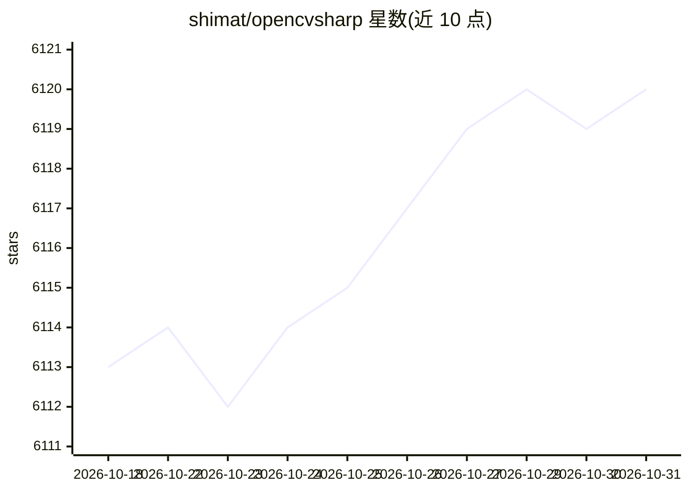

# shimat/opencvsharp

⭐ 6,120 · C# · Apache-2.0 · 推送 2026-10-26 · [GitHub](https://github.com/shimat/opencvsharp) · [官网](http://shimat.github.io/opencvsharp/) · 个人维护

**OpenCV 的跨平台 .NET 封装库，供 .NET 开发者做图像处理与计算机视觉**

OpenCvSharp 是 OpenCV 的跨平台 .NET wrapper，API 设计贴近原生 OpenCV C++ 接口，同时采用 C# 的类型化枚举、异常与确定性释放等惯例。以 NuGet 包分发，分 OpenCvSharp5（OpenCV 5.0.x，.NET 8+，活跃开发）与 OpenCvSharp4（OpenCV 4.13.0，支持 .NET Framework 4.6.1+，维护状态）两个并行系列。提供 Windows x64/ARM64、Linux x64/ARM64、macOS Intel/Apple Silicon 的原生绑定包，并有 full/headless/slim 三种模块档位。提供 Mat/Bitmap、Mat/WriteableBitmap 转换；不支持 CUDA，不能在 Unity/Xamarin 上运行。

## 筛选速览

| 维度 | 判定 | 备注 |
|---|---|---|
| AI 角色 | `ai-native` | 本体是模型或模型工具 |
| 许可风险 | `permissive` | Apache-2.0 |
| 部署形态 | `None` |  |
| 模型依赖 | — | README 未给出锁定关系 |
| 硬件要求 | — | 无带数字的原话,不猜 |
| 安装摩擦 | `medium` | 含编译或系统依赖之一 |
| 成熟度 | — | 结构信号不足 |

## 能力要点

- API 贴近原生 OpenCV C++ 接口，便于概念与代码迁移到 .NET
- 双系列 NuGet 包：OpenCvSharp5（.NET 8+）与 OpenCvSharp4（含 .NET Framework 支持）
- 覆盖 Windows/Linux/macOS 的 x64 与 ARM64 原生运行时包，含 full/headless/slim 档位
- Mat 算术链采用惰性求值表达式树，中间节点不持有非托管资源

## 适用场景

- 在 .NET 项目中做图像处理与计算机视觉开发
- 容器化/headless 服务中选择无 GTK3/X11 依赖的运行时包
- 将已有 OpenCV C++ 代码与经验迁移到 C# 环境

## 场景标签

`图像视频处理` · 领域:感知与多模态

## 证据(README 行号)

> L7: OpenCvSharp is a cross-platform .NET wrapper for OpenCV, providing a rich set of image processing and computer visio
> L67: * **OpenCvSharp5**: OpenCV 5.0.x with opencv_contrib

## 星数曲线

2026-10-18 6,113 → 2026-10-31 6,120（+7）

---
*卡片 v1 · prompt 1.4 · 生成 2026-10-20 · 置信度 high · 依据 README sha `d6deab15e7a1` · [字段定义](../../DATASET.md)*
