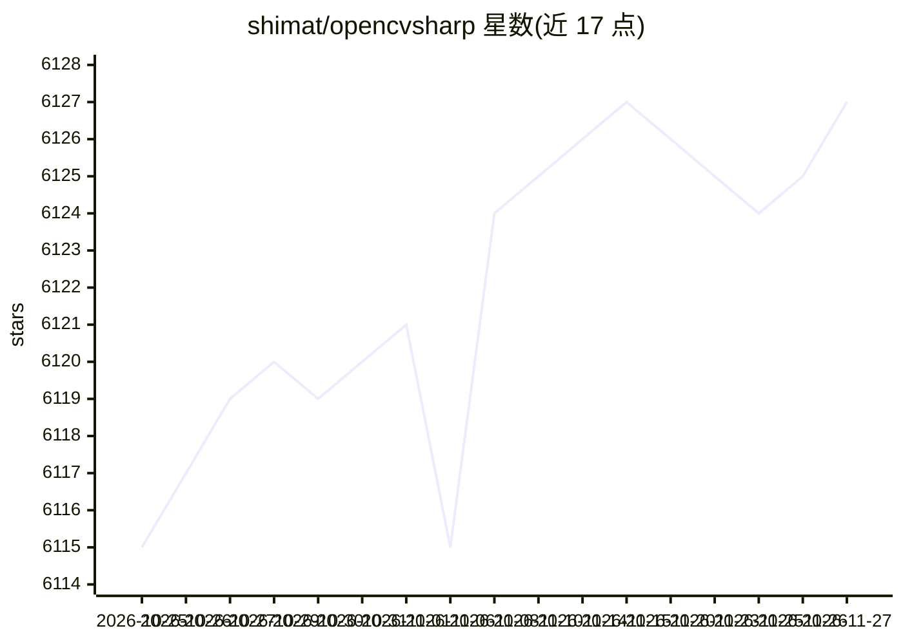

# shimat/opencvsharp

⭐ 6,127 · C# · Apache-2.0 · 推送 2026-11-25 · [GitHub](https://github.com/shimat/opencvsharp) · [官网](http://shimat.github.io/opencvsharp/) · 个人维护

**.NET 开发者调用 OpenCV 做图像处理的跨平台绑定库**

OpenCvSharp 为 OpenCV 提供 .NET 包装，API 贴近原生 OpenCV C++ 接口，使 OpenCV 的文档与代码可低成本迁移到 C#。按 OpenCV 5.x（.NET 8+）与 4.13.0（兼容 .NET Framework/.NET Standard）两条包族并行发布，全部经 NuGet 分发，并按 Windows x64/ARM64、Linux x64/ARM64、macOS Intel/Apple Silicon 提供 full/headless/slim 多档原生运行时包。明确不支持 Unity、Xamarin 与 CUDA；Linux full 包需 GTK3 支持窗口显示，headless/slim 无此依赖。

## 筛选速览

| 维度 | 判定 | 备注 |
|---|---|---|
| AI 角色 | `ai-native` | 本体是模型或模型工具 |
| 许可风险 | `permissive` | Apache-2.0 |
| 部署形态 | `None` |  |
| 模型依赖 | — | README 未给出锁定关系 |
| 硬件要求 | — | 无带数字的原话,不猜 |
| 安装摩擦 | `medium` | 含编译或系统依赖之一 |
| 成熟度 | — | 结构信号不足 |

## 能力要点

- API 贴近 OpenCV C++ 原生接口，支持原生风格函数调用与面向对象两种写法
- 提供 Mat→Bitmap(GDI+)/WriteableBitmap(WPF) 转换及 Avalonia 扩展包
- Linux 运行时包内置静态链接的 FFmpeg 与 Tesseract
- Mat 链式运算返回托管 MatExpr 表达式树，无原生资源泄漏

## 适用场景

- 在 C#/.NET 项目中做图像处理与计算机视觉开发
- 将现有 OpenCV C++/Python 代码迁移到 .NET 平台
- 在容器化服务中用 headless 包运行无 GUI 的视觉处理流水线

## 场景标签

`图像视频处理` · 领域:感知与多模态

## 证据(README 行号)

> L7: OpenCvSharp is a cross-platform .NET wrapper for OpenCV, providing a rich set of image processing and computer visio
> L84: **OpenCvSharp does not support CUDA.** If you want to use CUDA features, you need to customize the native bindings 
> L21: |**OpenCvSharp5**|5.1.x|.NET 8+|Active development — recommended for new projects|

## 星数曲线

2026-10-25 6,115 → 2026-11-27 6,127（+12）

---
*卡片 v1 · prompt 1.4 · 生成 2026-11-22 · 置信度 high · 依据 README sha `f27dd6ec34e7` · [字段定义](../../DATASET.md)*
