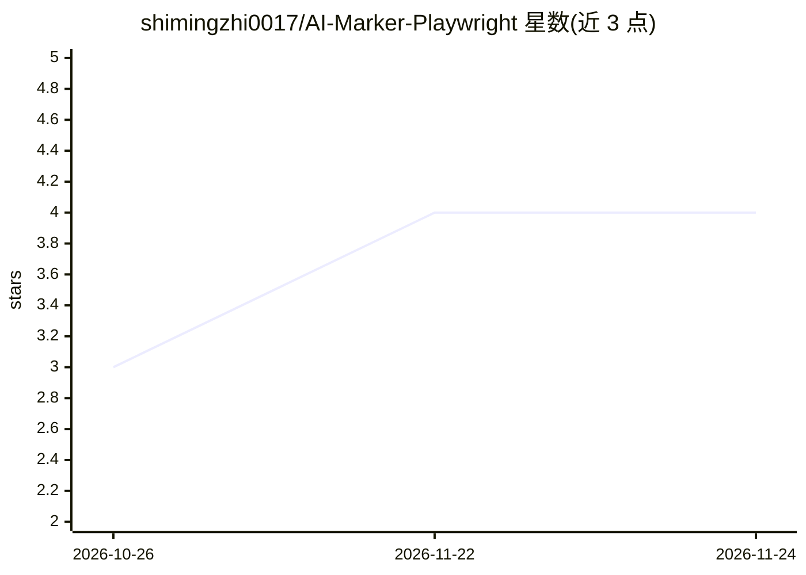

# shimingzhi0017/AI-Marker-Playwright

⭐ 4 · JavaScript · GPL-3.0 · 推送 2026-11-21 · [GitHub](https://github.com/shimingzhi0017/AI-Marker-Playwright) · [官网](https://github.com/shimingzhi0017/AI-Marker-Playwright/releases/latest) · 个人维护 · 中文 README

**给教师的本地 AI 阅卷工作台：自动评分与人工确认结合**

面向教师的本地可视化阅卷工具，主流程覆盖评分方案生成、模型配置、页面检查、自动评分、人工确认、历史追踪与结果导出。支持单双评与仲裁机制，主观题分差触发仲裁，评分理由与识别内容提交前可修改。提供 Windows 便携版（内置组件，无需 Node.js），源码版基于 Node.js 与 Playwright 驱动专用阅卷浏览器操作阅卷平台页面。数据均保存在本机，项目遵循 GPL-3.0。

## 筛选速览

| 维度 | 判定 | 备注 |
|---|---|---|
| AI 角色 | `ai-native` | 本体是模型或模型工具 |
| 许可风险 | `viral` | GPL-3.0 |
| 部署形态 | `library` | 以包/库形式分发 |
| 模型依赖 | — | README 未给出锁定关系 |
| 硬件要求 | — | 无带数字的原话,不猜 |
| 安装摩擦 | `low` | 无编译、无系统依赖或容器化 |
| 成熟度 | — | 结构信号不足 |

## 能力要点

- 评分标准生成与九学科三种评分口径（宽松/正常/严格）
- 单双评与仲裁：客观题逐项比对、主观题分差判断
- 独立并发任务、暂停控制与 JSON/CSV/带图 HTML 导出
- Windows 便携版解压即用，无需单独安装 Node.js

## 适用场景

- 在线阅卷平台上批量自动评分并人工复核后提交
- 为主观题生成可编辑的评分标准与分项细则
- 追踪阅卷历史并按学生/平台标识定位答卷导出结果

## 场景标签

`浏览器自动化` · 领域:效率与自动化

## 证据(README 行号)

> L3: 面向教师的本地可视化 AI 阅卷工作台。源码更新：**2026-11-12**；已发布的 Windows 便携包版本：**v2026.10.30**。本轮为源码更新，下载链接仍指向现有发布包。
> L5: 从“开始阅卷”主流程出发，完成评分方案、模型配置、页面检查、自动评分、人工确认、历史追踪与结果导出。
> L47: 4. 点击“检查页面”，确认识别结果后开始阅卷。

## 星数曲线

2026-10-26 3 → 2026-11-24 4（+1）

---
*卡片 v1 · prompt 1.4 · 生成 2026-11-21 · 置信度 high · 依据 README sha `6fff8233779f` · [字段定义](../../DATASET.md)*
