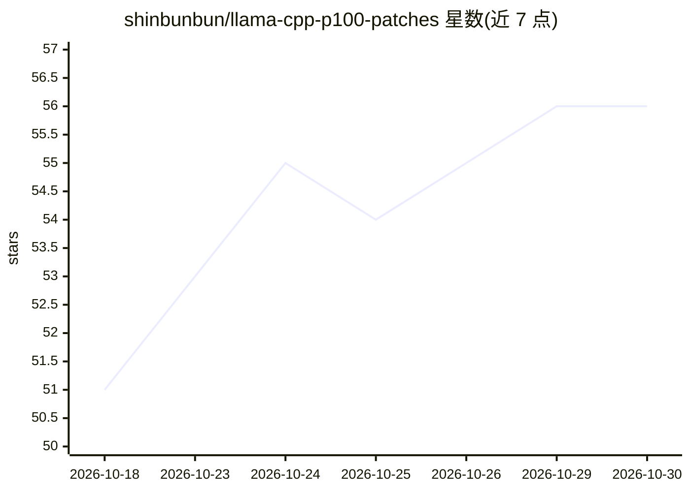

# shinbunbun/llama-cpp-p100-patches

⭐ 56 · Nix · MIT · 推送 2026-10-27 · [GitHub](https://github.com/shinbunbun/llama-cpp-p100-patches) · 个人维护 · 中文 README

**针对 llama.cpp 的 45 个性能补丁集，在 Tesla P100 上开发并测量**

为 llama.cpp v0.5.0 提供的 45 个性能补丁，在 Tesla P100（GP100, sm_60）上开发并逐项测量；仅 8 个限定 Pascal 硬件，其余为内核融合、调度器、采样路径等通用优化。含 MoE 长上下文（262k ctx）相关补丁，多数默认关闭、以环境变量开关。构建通过 Nix（nix build github:...#llama-cpp-sm60）完成编译，多数补丁输出与原版逐位一致。补丁未提交上游，仓库声明预期随上游修复而缩减。

## 筛选速览

| 维度 | 判定 | 备注 |
|---|---|---|
| AI 角色 | `ai-ecosystem` | LLM/agent 周边工具 |
| 许可风险 | `permissive` | MIT |
| 部署形态 | `None` |  |
| 模型依赖 | — | README 未给出锁定关系 |
| 硬件要求 | — | 无带数字的原话,不猜 |
| 安装摩擦 | `medium` | 含编译或系统依赖之一 |
| 成熟度 | — | 结构信号不足 |

## 能力要点

- 45 个补丁中仅 8 个限定 Pascal 硬件，其余为架构通用优化
- 逐补丁附测量数据，测试套件在 P100 上无复现失败
- 多数补丁默认输出与未打补丁版本逐位一致
- 通过 Nix 构建，nix flake check 校验补丁零偏移应用

## 适用场景

- 在 Tesla P100 等无 DP4A 的 Pascal 卡上运行 llama.cpp 推理
- 为稀疏注意力 MoE 模型跑超长上下文（262k token）
- 参考补丁的测量方法与 A/B 协议做内核优化

## 场景标签

`推理引擎` · 领域:训练与推理

## 证据(README 行号)

> L3: 45 performance patches for llama.cpp,
> L132: - All 45 patches are generated against llama.cpp **`v0.5.0`**, where they

## 星数曲线

2026-10-18 51 → 2026-10-30 56（+5）

---
*卡片 v1 · prompt 1.4 · 生成 2026-10-24 · 置信度 high · 依据 README sha `15de4180421e` · [字段定义](../../DATASET.md)*
