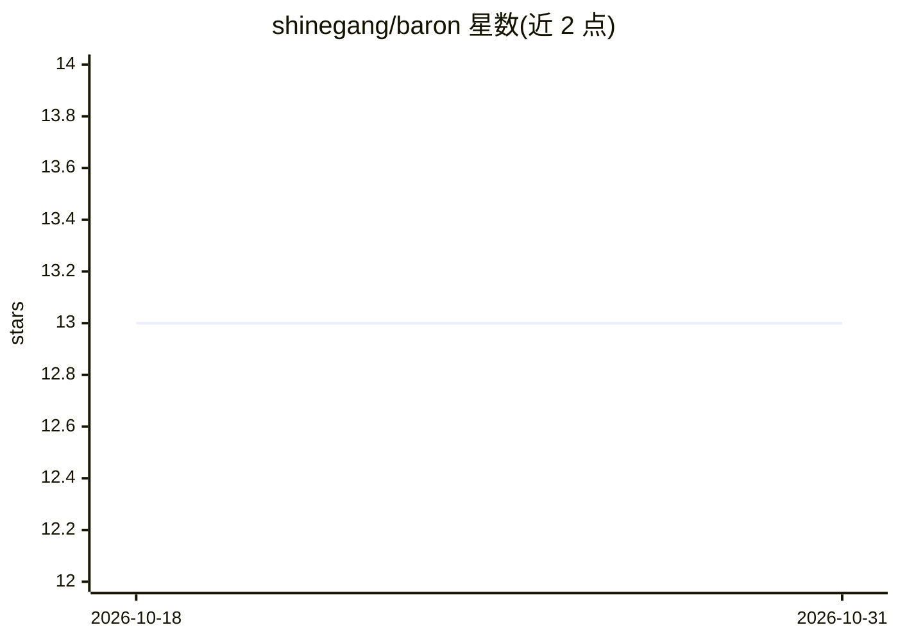

# shinegang/baron

⭐ 13 · Python · Apache-2.0 · 推送 2026-09-11 · [GitHub](https://github.com/shinegang/baron) · [官网](https://shinegang.click) · 个人维护

**编码 agent 的本地记忆服务器：跨会话存取项目状态并给回答溯源判定**

Python 3.12 编写的 MCP 记忆服务器，零第三方运行时依赖，通过 MCP stdio 与本机 JSON-RPC（127.0.0.1:8765）提供 30 个工具，供 Claude Code、Codex、Cursor、llama.cpp 等客户端接入。核心机制：知识图谱存储项目事实（claim+source），memory_checkpoint 在新会话取回项目脉络；grounding 引擎对每条回答给出 grounded/partial/ungrounded 判定并列出无依据句子；memory_retract 按规则关闭事实有效期且可撤销。自身不调用模型、数据不出本机，图从空开始。声称为 Public alpha（0.6.1），尚无 PyPI 包，需 git clone 或 pip install . 安装。

## 筛选速览

| 维度 | 判定 | 备注 |
|---|---|---|
| AI 角色 | `ai-ecosystem` | LLM/agent 周边工具 |
| 许可风险 | `permissive` | Apache-2.0 |
| 部署形态 | `library` | 以包/库形式分发 |
| 模型依赖 | — | README 未给出锁定关系 |
| 硬件要求 | — | 无带数字的原话,不猜 |
| 安装摩擦 | `low` | 无编译、无系统依赖或容器化 |
| 成熟度 | `idea` | |

## 能力要点

- 每条回答输出 grounded/partial/ungrounded 判定并逐句指出无依据声明
- 跨会话取回项目线程、最近决策与未决事项（memory_checkpoint）
- 零第三方运行时依赖，30 个工具经 MCP stdio 与 JSON-RPC 提供
- Claude Code PreCompact/SessionStart 钩子在上下文压缩后重注入图谱切片

## 适用场景

- 会话结束后在新会话恢复项目进展与决策记录
- 核验 agent 回答是否有图谱依据，拦截编造内容
- 多客户端（Claude Code/Codex/Cursor 等）共享同一本地项目记忆

## 场景标签

`Agent 记忆` · 领域:Agent 开发

## 证据(README 行号)

> L27: A memory server in Python 3.12 with no third-party runtime dependency. MCP over
> L121: |**5. Any model, any client**|**30** tools over MCP stdio and JSON-RPC on `127.0.0.1:8765`. Claude Code, Codex, Cu

## 星数曲线

2026-10-18 13 → 2026-10-31 13（+0）

---
*卡片 v1 · prompt 1.4 · 生成 2026-10-31 · 置信度 mid · 依据 README sha `9d6568e76c7d` · [字段定义](../../DATASET.md)*
