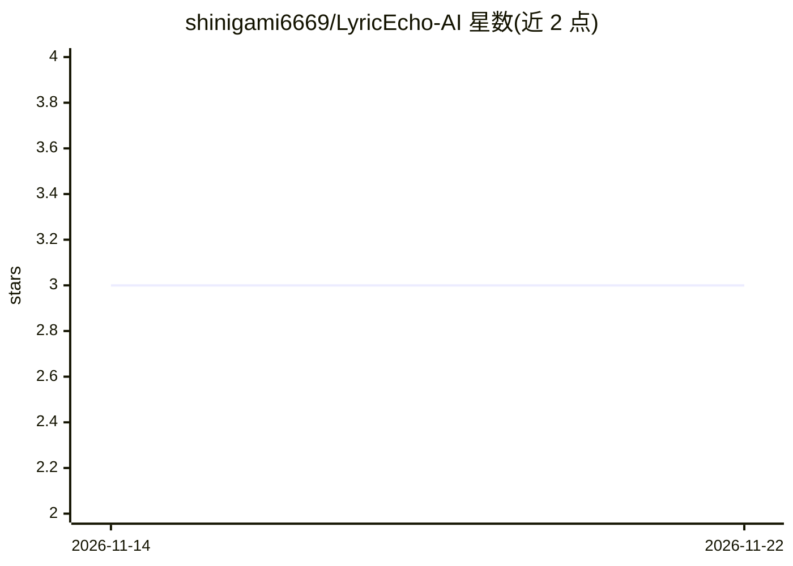

# shinigami6669/LyricEcho-AI

⭐ 3 · Kotlin · MIT · 推送 2026-11-14 · [GitHub](https://github.com/shinigami6669/LyricEcho-AI) · 个人维护 · 中文 README

**Android/Windows 双语歌词同步悬浮窗播放伴侣，AI 逐行翻译**

LyricEcho AI 是 Android 与 Windows 平台的音乐伴侣应用：检测受支持的音乐播放器，通过 LRCLIB 查询同步歌词，悬浮窗保持当前行可见，并提供播放与时间轴调整控制。翻译功能需用户自备凭据连接 Gemini 或兼容 AI 提供商，翻译结果连同歌词可存入本地库。Android 需 7.0+ 并授予通知与悬浮窗权限；Windows 需 64 位 Win10 19041+，单文件版内含 .NET 运行时，可执行文件未签名会触发发布者警告。界面支持波斯语等五种语言。

## 筛选速览

| 维度 | 判定 | 备注 |
|---|---|---|
| AI 角色 | `ai-enhanced` | 去掉 AI 部分产品仍成立 |
| 许可风险 | `permissive` | MIT |
| 部署形态 | `None` |  |
| 模型依赖 | — | README 未给出锁定关系 |
| 硬件要求 | — | 无带数字的原话,不猜 |
| 安装摩擦 | `medium` | 含编译或系统依赖之一 |
| 成熟度 | — | 结构信号不足 |

## 能力要点

- 悬浮歌词窗保持当前行可见，可手动调整时间轴
- 通过 LRCLIB 查询歌词，翻译由用户自备 API key 的 Gemini 或兼容提供商完成
- 本地歌词与翻译库，界面支持波斯语/英语/阿拉伯语/西班牙语/土耳其语
- 提供 Android APK 与 Windows EXE 预编译包及源码构建说明

## 适用场景

- 边听歌边看原文与母语逐行对照歌词
- 使用其他应用时通过悬浮窗跟唱卡拉OK
- 为波斯语等界面语言环境提供本地化歌词体验

## 场景标签

`AI 写作` · 领域:内容生成

## 证据(README 行号)

> L12: Follow the original lyrics while reading a translation in your chosen language. LyricEcho detects supported media p
> L33: - **Translations** — choose a language and connect Gemini or a compatible AI provider using your own credentials.

## 星数曲线

2026-11-14 3 → 2026-11-22 3（+0）

---
*卡片 v1 · prompt 1.4 · 生成 2026-11-21 · 置信度 high · 依据 README sha `af85db0ac609` · [字段定义](../../DATASET.md)*
