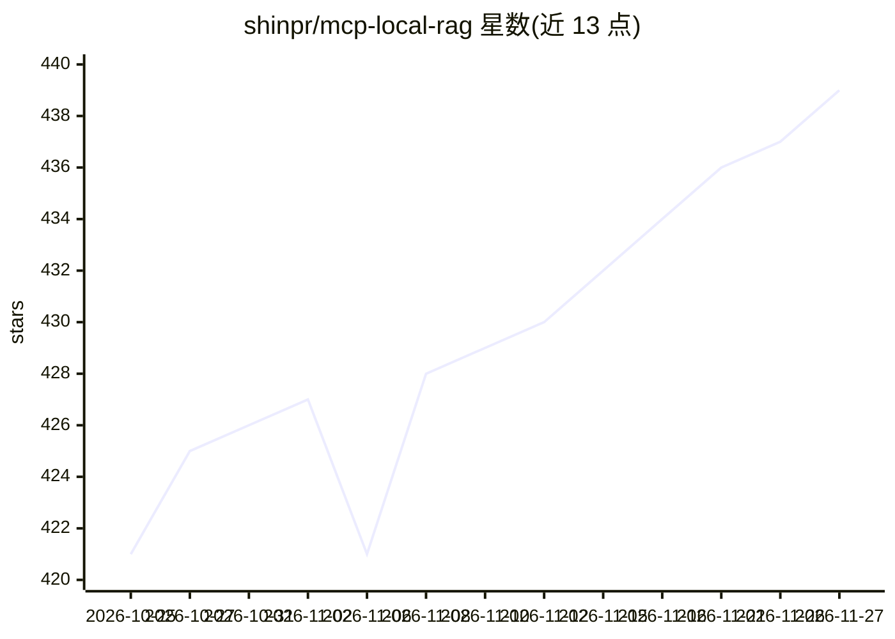

# shinpr/mcp-local-rag

⭐ 439 · TypeScript · MIT · 推送 2026-11-13 · [GitHub](https://github.com/shinpr/mcp-local-rag) · 个人维护 · 中文 README

**给开发者的本地 RAG 服务器：私密检索代码与技术文档**

面向开发者的本地优先 RAG 服务器：索引本机 PDF、DOCX、Markdown 与文本文件，结合语义相似度与关键词匹配检索 API 名称、类名、错误码等精确术语，结果附带原文段落及标题、行号或页码供溯源。通过 MCP 客户端或 CLI 使用，不将文档发送到外部嵌入 API；无需 API key、Docker、Python 或外部数据库，首次下载约 90 MB 嵌入模型后可离线运行。支持外部重排序命令、Hugging Face 镜像端点与多文档根配置。

## 筛选速览

| 维度 | 判定 | 备注 |
|---|---|---|
| AI 角色 | `ai-native` | 本体是模型或模型工具 |
| 许可风险 | `permissive` | MIT |
| 部署形态 | `library` | 以包/库形式分发 |
| 模型依赖 | — | README 未给出锁定关系 |
| 硬件要求 | — | 无带数字的原话,不猜 |
| 安装摩擦 | `low` | 无编译、无系统依赖或容器化 |
| 成熟度 | — | 结构信号不足 |

## 能力要点

- 语义+关键词混合检索，支持 --scope 路径前缀过滤与外部重排序
- 支持 9 个 MCP 工具与 CLI（ingest/sync/query/read-neighbors/relocate/skills）
- BASE_DIR 即安全边界，文件操作限制在配置的文档根内
- 提供 Agent Skills 安装命令（Claude Code/Codex）

## 适用场景

- 在终端或 MCP 客户端中检索本地代码与技术文档
- 不联网上传文档的前提下对私有资料做语义问答
- 将 JSON 查询结果通过管道接入其他工具

## 场景标签

`RAG` · 领域:知识与检索

## 证据(README 行号)

> L21: Search private documents from an MCP client or the terminal without sending them to an
> L24: mcp-local-rag indexes PDF, DOCX, Markdown, and text files on your machine. Search combines
> L44: Use one of the examples below, or register `npx -y mcp-local-rag` and set `BASE_DIR` using your

## 星数曲线

2026-10-25 421 → 2026-11-27 439（+18）

---
*卡片 v1 · prompt 1.4 · 生成 2026-11-25 · 置信度 high · 依据 README sha `aa978862917d` · [字段定义](../../DATASET.md)*
