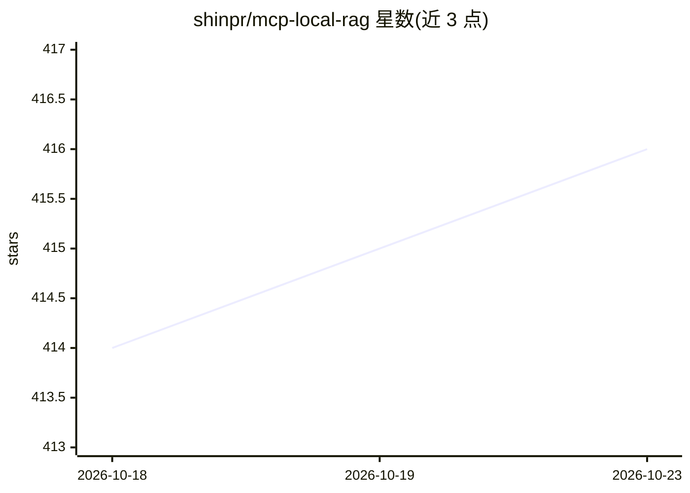

# shinpr/mcp-local-rag

⭐ 416 · TypeScript · MIT · 推送 2026-10-22 · [GitHub](https://github.com/shinpr/mcp-local-rag) · 个人维护 · 中文 README

**本地优先的 RAG 搜索服务器：为 MCP 客户端与 CLI 检索私有文档**

面向开发者的本地 RAG 服务器，以 MCP 工具（sync、query_documents、read_chunk_neighbors 等 9 个）或独立 CLI 运行。索引本机 PDF/DOCX/Markdown/文本文件，检索结合语义相似度与关键词加权，结果附带来源段落及标题、行号或页码。默认使用 Xenova/all-MiniLM-L6-v2 嵌入模型经 ONNX Runtime 本地计算，首次使用需联网下载约 90 MB 模型，此后离线工作；无需 API key、Docker、Python 或外部数据库。文件操作限制在配置的文档根目录内。

## 筛选速览

| 维度 | 判定 | 备注 |
|---|---|---|
| AI 角色 | `ai-ecosystem` | LLM/agent 周边工具 |
| 许可风险 | `permissive` | MIT |
| 部署形态 | `library` | 以包/库形式分发 |
| 模型依赖 | — | README 未给出锁定关系 |
| 硬件要求 | — | 无带数字的原话,不猜 |
| 安装摩擦 | `low` | 无编译、无系统依赖或容器化 |
| 成熟度 | — | 结构信号不足 |

## 能力要点

- 语义+关键词混合检索，可匹配 API 名、类名、错误码等精确术语
- 默认嵌入模型本地运行，首次下载约 90 MB 后离线可用
- 9 个 MCP 工具 + CLI 双使用方式，JSON 输出可管道传递
- 支持外部重排命令（RAG_RERANK_CMD）、多文档根、glob 忽略规则

## 适用场景

- 在 Claude Code/Codex/Cursor 等 MCP 客户端中检索本地技术文档与代码文档
- 不经 MCP 客户端，用 CLI 对本地文档做索引与混合搜索
- 隐私敏感场景下不向嵌入 API 发送私有文档

## 场景标签

 · 领域:开发者工具/RAG 基础设施

## 证据(README 行号)

> L21: Search private documents from an MCP client or the terminal without sending them to an
> L160: |`query_documents`|Search with semantic matching and keyword boost|

## 星数曲线

2026-10-18 414 → 2026-10-23 416（+2）

---
*卡片 v1 · prompt 1.4 · 生成 2026-10-21 · 置信度 high · 依据 README sha `bc4f73f35e22` · [字段定义](../../DATASET.md)*
