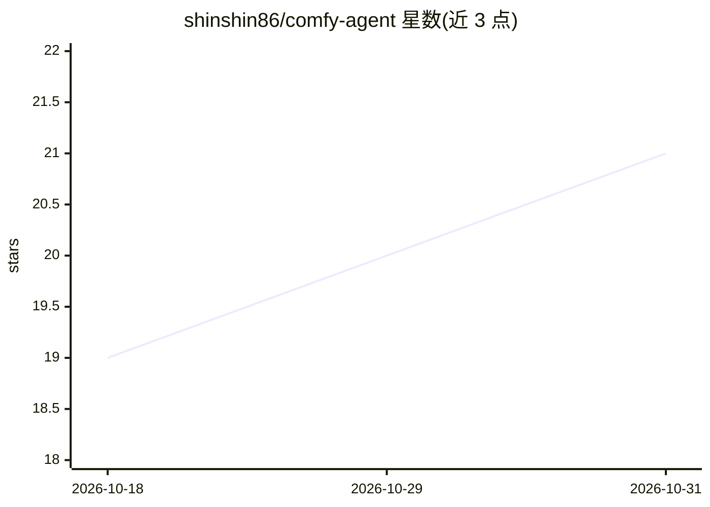

# shinshin86/comfy-agent

⭐ 21 · TypeScript · MIT · 推送 2026-10-26 · [GitHub](https://github.com/shinshin86/comfy-agent) · [官网](https://www.npmjs.com/package/comfy-agent) · 个人维护

**无 GPU 创作者通过 CLI 将图像/视频/音乐生成委托给远程 ComfyUI**

面向无本地 GPU 的个人创作者的 Node.js CLI：连接任意 ComfyUI 服务器（Google Colab、RunPod、家用 GPU），提交工作流、等待完成并将产出保存在本地 .comfy-agent/ 目录，预设与输出在服务器重置后保留。内置 49 个 Colab kit 目录（图像/视频/音频模型，标注最低 GPU 与验证状态），通过 cloudflared 隧道连接 Colab。另为 Claude Code、Codex、Cursor、Gemini CLI、OpenClaw 等 agent 提供可安装技能与策略文档，支持结构化 JSON 错误契约、角色记忆与生成历史管理。需 Node.js 22+ 与可达的 ComfyUI 服务器。

## 筛选速览

| 维度 | 判定 | 备注 |
|---|---|---|
| AI 角色 | `ai-ecosystem` | LLM/agent 周边工具 |
| 许可风险 | `permissive` | MIT |
| 部署形态 | `library` | 以包/库形式分发 |
| 模型依赖 | — | README 未给出锁定关系 |
| 硬件要求 | — | 无带数字的原话,不猜 |
| 安装摩擦 | `low` | 无编译、无系统依赖或容器化 |
| 成熟度 | — | 结构信号不足 |

## 能力要点

- connect/run 命令驱动远程 ComfyUI，预设与输出保存在本地
- 49 个 Colab kit 目录，含 GPU 要求、许可与 E2E 验证状态等机器可读数据
- 为 Claude Code/Codex/Cursor/Gemini CLI/OpenClaw 安装 bundled skill 与 agent playbook
- 仅 3 个退出码与 --json 结构化错误契约

## 适用场景

- 无本地 GPU 时通过 Colab/RunPod 等 ComfyUI 服务器生成图像、视频与音乐
- 让 AI agent 按策略文档自动驱动 ComfyUI 工作流
- 用角色（character）机制维护可复用的提示词、参考图与 LoRA 并管理生成历史

## 场景标签

`图像生成` `视频生成` · 领域:内容生成

## 证据(README 行号)

> L8: Comfy Agent is a CLI for GPU-less individual creators to delegate image, video,
> L27: No GPU? Jump to Run on Google Colab. Driving this from an AI
> L43: ## For AI agents (Claude Code, Codex, Cursor, Gemini CLI, OpenClaw)

## 星数曲线

2026-10-18 19 → 2026-10-31 21（+2）

---
*卡片 v1 · prompt 1.4 · 生成 2026-10-28 · 置信度 high · 依据 README sha `7059c48f9ca4` · [字段定义](../../DATASET.md)*
