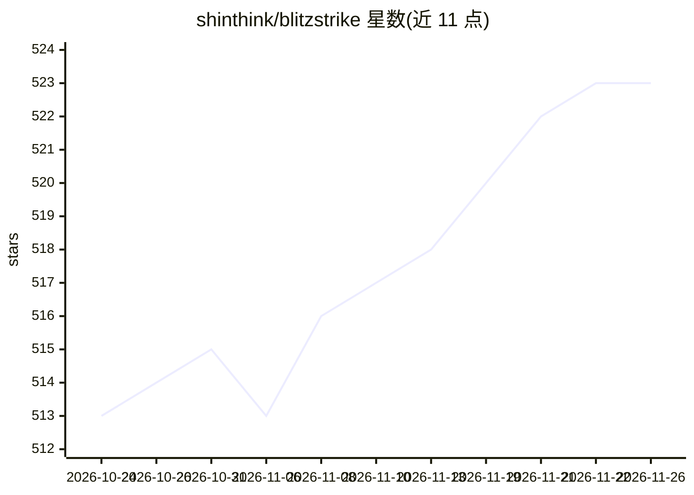

# shinthink/blitzstrike

⭐ 523 · TypeScript · MIT · 推送 2026-11-04 · [GitHub](https://github.com/shinthink/blitzstrike) · [官网](https://github.com/shinthink/blitzstrike) · 个人维护

**MCP 安全审计工具服务器：给 AI agent 提供侦察、分析与验证工具**

以 MCP 服务器形式交付的三层渗透测试方法论（TypeScript/Bun 实现）：BLITZ 枚举攻击面，EAGLE-EYE 做 source-to-sink 污点追踪，STRIKE 做带标记反射与阴性对照的活体验证，一次 run_engagement 调用完成全流程并强制 scope 检查。另含 Web3 Solidity 审计与 Foundry PoC、CWE/CVE 情报层、130 工具目录、317 工具手册与 17 个 playbooks。由接入的 LLM agent（Claude/Cursor 等 MCP 客户端）驱动规划和路由，本产品提供确定性工具与守护栏。

## 筛选速览

| 维度 | 判定 | 备注 |
|---|---|---|
| AI 角色 | `ai-ecosystem` | LLM/agent 周边工具 |
| 许可风险 | `permissive` | MIT |
| 部署形态 | `library` | 以包/库形式分发 |
| 模型依赖 | — | README 未给出锁定关系 |
| 硬件要求 | — | 无带数字的原话,不猜 |
| 安装摩擦 | `low` | 无编译、无系统依赖或容器化 |
| 成熟度 | — | 结构信号不足 |

## 能力要点

- 三层方法论：BLITZ 侦察→EAGLE-EYE 污点分析→STRIKE 活体验证，验证后才报告
- run_engagement 单次调用完成 scope 门控→分诊→链路富化→findings
- Web3 审计：13 类 Solidity 缺陷检测 + 可执行 Foundry PoC
- 130 工具目录、317+ 手册、17 playbooks，情报数据来自 PayloadsAllTheThings/nuclei-templates

## 适用场景

- 让接入的 AI agent 对源码目录或 URL 运行结构化安全审计
- 在报告漏洞前通过活体验证与 scope 检查消除误报
- 对智能合约做确定性审计并生成可执行的 Foundry 证明
- 查询 CVE、WAF 签名、payload 与 nuclei 模板等安全情报

## 场景标签

`网络安全` · 领域:学习与行业

## 证据(README 行号)

> L15: source analysis, and validation — delivered as a universal MCP server. It
> L30: Blitz Strike is a Model Context Protocol (MCP) server (TypeScript / Bun) that
> L58: Blitz Strike is driven by the LLM — Claude, Hermes, OpenCode, Codex, or any

## 星数曲线

2026-10-24 513 → 2026-11-26 523（+10）

---
*卡片 v1 · prompt 1.4 · 生成 2026-11-25 · 置信度 high · 依据 README sha `0e2db9a99a62` · [字段定义](../../DATASET.md)*
