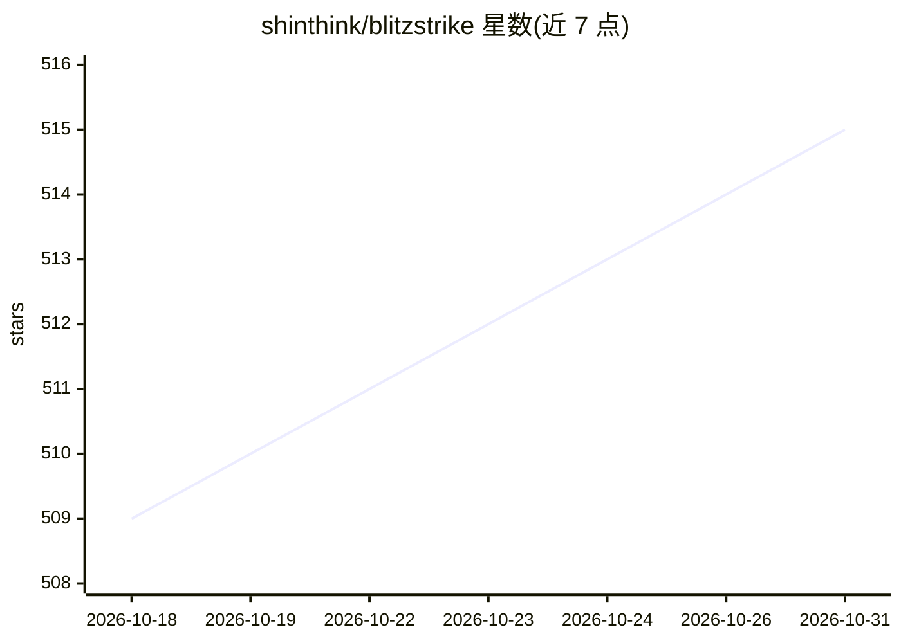

# shinthink/blitzstrike

⭐ 515 · TypeScript · MIT · 推送 2026-10-18 · [GitHub](https://github.com/shinthink/blitzstrike) · [官网](https://github.com/shinthink/blitzstrike) · 个人维护

**渗透测试 MCP 服务器：为 LLM agent 提供三层安全审计工具**

基于 TypeScript/Bun 的 Model Context Protocol 服务器，将结构化渗透测试方法论封装为可调用工具：BLITZ 层枚举攻击面，EAGLE-EYE 层做源到汇的污点与数据流分析（支持 PHP/JS/TS/Python/Java），STRIKE 层做带阴性对照的活体验证、范围检查与报告生成。由 LLM agent（Claude Code、Cursor 等 MCP 客户端）驱动，单个 run_engagement 调用完成完整审计流程。另含 Web3 合约审计（13 类缺陷、Foundry 可执行 PoC）、WAF 检测、CVE 关联、payload/nuclei 模板查询等情报数据层。通过 npx 零安装分发，FOFA 查询需自备凭据。

## 筛选速览

| 维度 | 判定 | 备注 |
|---|---|---|
| AI 角色 | `ai-ecosystem` | LLM/agent 周边工具 |
| 许可风险 | `permissive` | MIT |
| 部署形态 | `library` | 以包/库形式分发 |
| 模型依赖 | — | README 未给出锁定关系 |
| 硬件要求 | — | 无带数字的原话,不猜 |
| 安装摩擦 | `low` | 无编译、无系统依赖或容器化 |
| 成熟度 | — | 结构信号不足 |

## 能力要点

- 三层方法论：攻击面枚举→污点追踪→活体验证，未验证发现不上报
- 130 工具目录与 317 份工具手册、17 份渗透 playbook 接入调用流程
- Web3 审计：13 类 Solidity 缺陷检测并生成 Foundry 可执行 PoC
- 单次 run_engagement 调用完成范围检查→分诊→链路富化→报告

## 适用场景

- 在 Claude Code/Cursor 等 MCP 客户端中对源码或在线目标做渗透测试
- 对 Web 应用做污点分析定位可达且未鉴权的危险汇点
- 对 Solidity 合约做确定性审计并生成可执行的漏洞复现测试

## 场景标签

`网络安全` · 领域:学习与行业

## 证据(README 行号)

> L30: Blitz Strike is a Model Context Protocol (MCP) server (TypeScript / Bun) that
> L33: Claude Code, Cursor, Hermes, OpenCode, Claude Desktop, Gemini, or any MCP client.
> L59: MCP client. **The LLM is the brain** (plans, routes, delegates, judges); **Blitz

## 星数曲线

2026-10-18 509 → 2026-10-31 515（+6）

---
*卡片 v1 · prompt 1.4 · 生成 2026-10-21 · 置信度 high · 依据 README sha `1ec025ed233e` · [字段定义](../../DATASET.md)*
