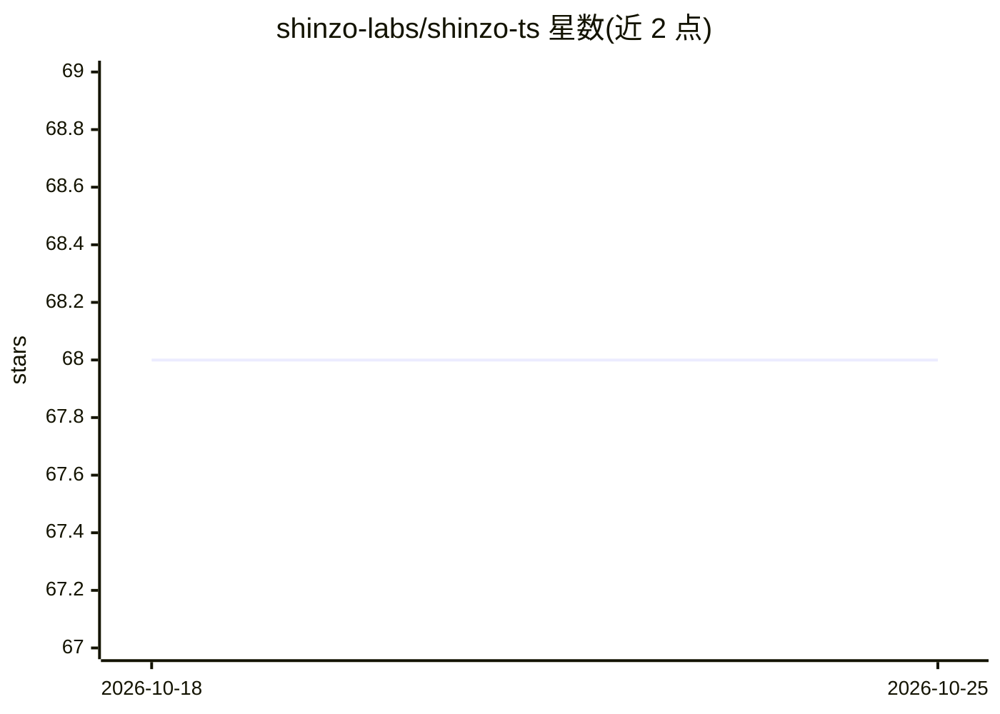

# shinzo-labs/shinzo-ts

⭐ 68 · TypeScript · MIT · 推送 2025-12-08 · [GitHub](https://github.com/shinzo-labs/shinzo-ts) · [官网](https://shinzo.ai) · 组织维护

**MCP 服务器的 OpenTelemetry 可观测性 TypeScript SDK**

为 TypeScript 编写的 MCP 服务器提供 OpenTelemetry 兼容的埋点 SDK：通过 instrumentServer 对服务器插桩，采集 agent 使用模式、工具调用上下文与服务器性能数据，导出至任意 OpenTelemetry 兼容的接收服务（含 Shinzo 平台）。TelemetryConfig 支持采样率、OTLP HTTP/gRPC/console 三种导出类型、bearer/apiKey/basic 认证、默认开启的 PII 清洗与自定义数据处理函数。以 npm 包形式安装，面向 MCP 服务器开发者。

## 筛选速览

| 维度 | 判定 | 备注 |
|---|---|---|
| AI 角色 | `ai-ecosystem` | LLM/agent 周边工具 |
| 许可风险 | `permissive` | MIT |
| 部署形态 | `library` | 以包/库形式分发 |
| 模型依赖 | — | README 未给出锁定关系 |
| 硬件要求 | — | 无带数字的原话,不猜 |
| 安装摩擦 | `low` | 无编译、无系统依赖或容器化 |
| 成熟度 | — | 结构信号不足 |

## 能力要点

- 对 TypeScript MCP 服务器注入 OpenTelemetry 埋点，采集 trace 与指标
- 支持 otlp-http/otlp-grpc/console 三种导出类型与多种认证方式
- 默认开启 PII 自动清洗，可自定义 sanitizer 与数据处理函数
- 兼容任意 OpenTelemetry ingest 服务，不绑定单一平台

## 适用场景

- 为自己的 MCP 服务器接入监控与性能分析
- 分析 agent 对 MCP 工具的调用模式
- 将 MCP 服务器遥测数据接入现有 OpenTelemetry 收集链路

## 场景标签

`LLM 可观测性` · 领域:评测与运维

## 证据(README 行号)

> L5:  Shinzo TypeScript SDK: Complete Observability for MCP Servers
> L13:  The SDK provides OpenTelemetry-compatible instrumentation for TypeScript MCP servers. Gain insight into agent usag

## 星数曲线

2026-10-18 68 → 2026-10-25 68（+0）

---
*卡片 v1 · prompt 1.4 · 生成 2026-10-24 · 置信度 high · 依据 README sha `b462b8a26718` · [字段定义](../../DATASET.md)*
