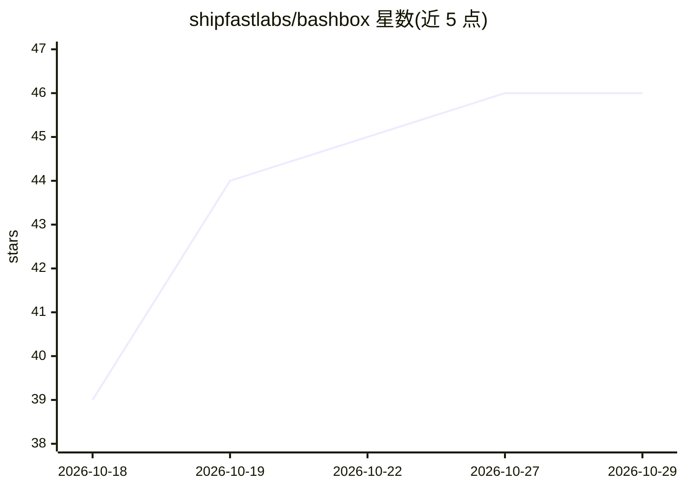

# shipfastlabs/bashbox

⭐ 46 · PHP · MIT · 推送 2026-10-19 · [GitHub](https://github.com/shipfastlabs/bashbox) · 组织维护

**给 AI agent 用的沙箱化 bash 解释器（纯 PHP 实现）**

用纯 PHP 8.4+ 实现的 bash 解释器，不调用 proc_open/exec/shell_exec，不执行宿主程序。每条命令是一个 PHP 类，文件操作在虚拟文件系统中进行，网络默认关闭。提供四种文件系统后端（InMemoryFs/OverlayFs/ReadWriteFs/MountableFs）与磁盘配额，支持管道、fd 重定向、here-doc、数组、函数等 bash 语义，并有命令数、循环迭代、输出大小等硬性执行限额。面向需要在服务端安全执行 AI 生成 bash 脚本的场景，通过 Composer 安装。

## 筛选速览

| 维度 | 判定 | 备注 |
|---|---|---|
| AI 角色 | `ai-ecosystem` | LLM/agent 周边工具 |
| 许可风险 | `permissive` | MIT |
| 部署形态 | `None` |  |
| 模型依赖 | — | README 未给出锁定关系 |
| 硬件要求 | — | 无带数字的原话,不猜 |
| 安装摩擦 | `low` | 无编译、无系统依赖或容器化 |
| 成熟度 | — | 结构信号不足 |

## 能力要点

- 纯 PHP 实现的 bash 解释器，零系统调用、无容器启动开销
- 四种文件系统后端与磁盘配额，默认完全隔离真实文件系统与网络
- 17 类执行限额（命令数/循环迭代/输出大小/AST 深度等）可配置
- 网络访问可配置 URL 前缀白名单与私网 IP 拒绝（SSRF 防护）

## 适用场景

- AI 编码助手生成的 bash 脚本在我方服务器上安全执行
- 代码执行平台或 CI/CD 中运行不受信任的 bash 脚本
- 需要保留 bash 语义但禁止真实文件系统与网络访问的教学/测试环境

## 场景标签

`网络安全` · 领域:学习与行业

## 证据(README 行号)

> L8: **BashBox** is a sandboxed bash interpreter for AI agents, written in pure PHP 8.4+. It does not use `proc_open`, `e
> L33: Perfect for AI agents, code execution platforms, CI/CD systems, or anywhere you need to run untrusted bash scripts 

## 星数曲线

2026-10-18 39 → 2026-10-29 46（+7）

---
*卡片 v1 · prompt 1.4 · 生成 2026-10-25 · 置信度 high · 依据 README sha `acdd57fbde57` · [字段定义](../../DATASET.md)*
