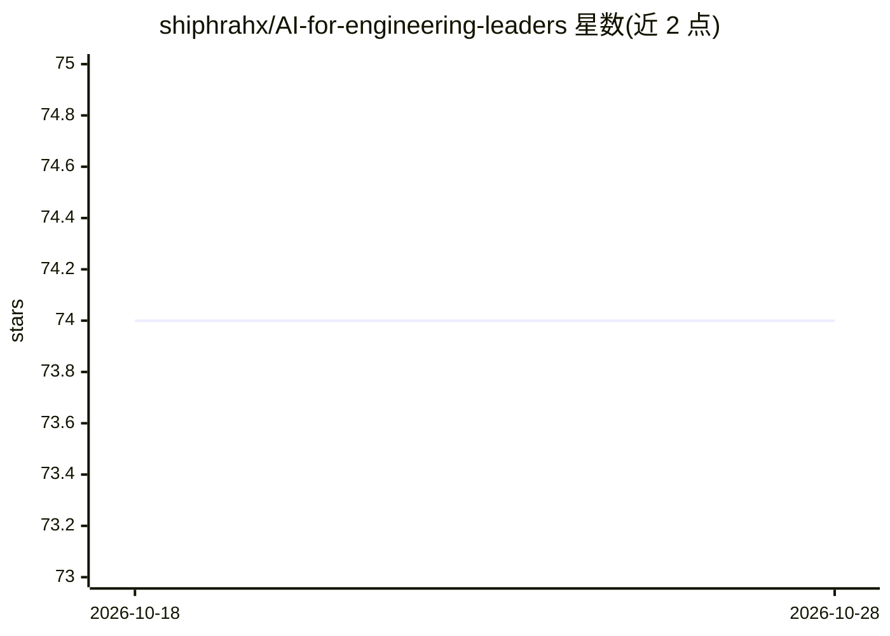

# shiphrahx/AI-for-engineering-leaders

⭐ 74 · Python · MIT · 推送 2026-07-09 · [GitHub](https://github.com/shiphrahx/AI-for-engineering-leaders) · 个人维护

**面向工程管理者的 100 条提示词与 84 条 Agent 技能库**

为工程经理、总监与 VP 提供的提示词与技能集合：100 条按情景组织的复制粘贴模板，覆盖周报沟通、规划文档、人员管理、事件管理、架构、招聘与技�术领导力等 7 大类，每条含占位符、示例与调优说明；另提供 84 条 Agent 可执行的技能文件（SKILL.md 格式），可由 Claude Code、Copilot、Cursor 等 Agent 直接执行任务。支持任意 AI 工具使用，附带终端浏览 CLI 脚本。

## 筛选速览

| 维度 | 判定 | 备注 |
|---|---|---|
| AI 角色 | `ai-knowledge` | 知识聚合/清单类 |
| 许可风险 | `permissive` | MIT |
| 部署形态 | `None` |  |
| 模型依赖 | — | README 未给出锁定关系 |
| 硬件要求 | — | 无带数字的原话,不猜 |
| 安装摩擦 | `low` | 无编译、无系统依赖或容器化 |
| 成熟度 | — | 结构信号不足 |

## 能力要点

- 100 条情景化提示词模板，7 个类别组织
- 84 条 Agent 可执行技能（SKILL.md 可移植格式）
- 每条提示词含占位符、示例输入输出与调优说明
- 提供 python tools/skills_cli.py 终端浏览/搜索工具

## 适用场景

- 工程经理用模板快速生成高管状态更新或事件通报
- 让 Claude Code/Cursor 等 Agent 按 SKILL.md 直接产出管理文档
- 团队制定 AI 辅助编码规范与 Agent 工作流设计

## 场景标签

`提示工程` · 领域:Agent 开发

## 证据(README 行号)

> L7: 100 situation-specific **prompts** and 84 agent-ready **skills** for engineering managers, directors, and VPs.
> L10: - **Skills** — the same expertise packaged so an agent (Claude Code, Copilot, Cursor, or any LLM) can *act*: gather

## 星数曲线

2026-10-18 74 → 2026-10-28 74（+0）

---
*卡片 v1 · prompt 1.4 · 生成 2026-10-24 · 置信度 high · 依据 README sha `b1a653f274a4` · [字段定义](../../DATASET.md)*
