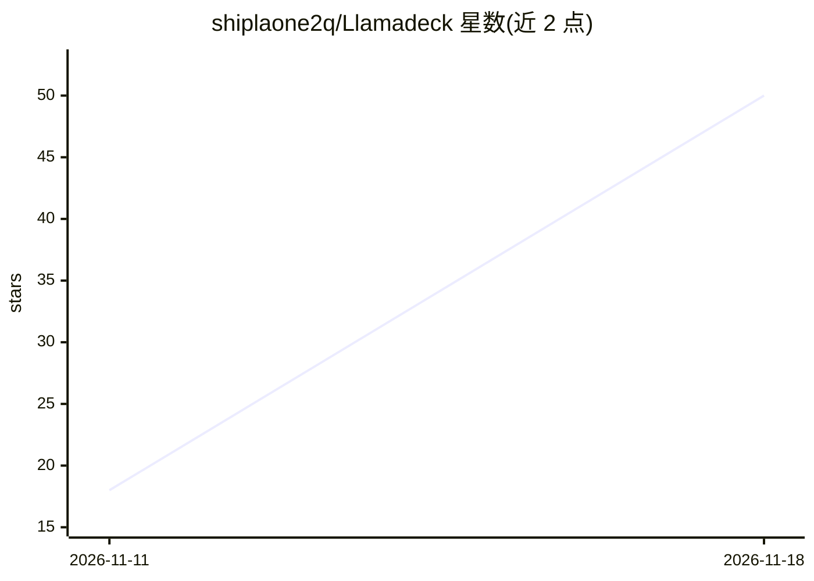

# shiplaone2q/Llamadeck

⭐ — · [GitHub]() · 个人维护

**统一管理与路由 llama.cpp/MLX/vLLM 模型的 CLI 工具**

Go 编写的模型服务管理工具：用单一 CLI 与 Web 仪表盘管理 llama.cpp、MLX（Apple Silicon）与 vLLM 后端的推理实例，支持从 HuggingFace 下载 GGUF/Safetensors 模型、动态多模型实例、空闲超时与 LRU 驱逐等资源策略。对外暴露 OpenAI 兼容与 Anthropic messages 端点，可按实例名路由请求，也支持远程实例的分布式部署与 Docker 容器化后端。安装需先准备任一后端，提供二进制下载、Docker 与源码编译三种方式。

## 筛选速览

| 维度 | 判定 | 备注 |
|---|---|---|
| AI 角色 | `ai-ecosystem` | LLM/agent 周边工具 |
| 许可风险 | `permissive` | — |
| 部署形态 | `self-host` | docker 或自建部署 |
| 模型依赖 | local-ok | 支持本地模型 |
| 硬件要求 | — | 无带数字的原话,不猜 |
| 安装摩擦 | `low` | 无编译、无系统依赖或容器化 |
| 成熟度 | — | 结构信号不足 |

## 能力要点

- 原生支持 llama.cpp、MLX、vLLM 后端及任意 OpenAI 兼容自定义后端
- 从 HuggingFace 下载 GGUF/Safetensors 模型
- llama.cpp 路由模式下单实例按需加载多模型
- OpenAI/Anthropic 兼容端点与 React Web 仪表盘

## 适用场景

- 在一台机器上同时管理多个本地模型的推理实例
- 用统一 API 接入并按需切换不同后端的模型
- 在远程主机部署实例并集中管理路由

## 场景标签

`推理引擎` `模型网关` · 领域:Agent 开发

## 证据(README 行号)

> L5: **Unified management and routing for llama.cpp, MLX and vLLM models with web dashboard.**
> L20: - **API Compatible**: OpenAI chat completions and resources endpoints, Anthropic messages endpoint (depending on ba
> L21: - **Multi-Backend Support**: Native support for llama.cpp, MLX (Apple Silicon optimized), and vLLM, plus any OpenAI

## 星数曲线

2026-11-11 18 → 2026-11-18 50（+32）

---
*卡片 v1 · prompt 1.4 · 生成 2026-11-18 · 置信度 mid · 依据 README sha `4516ab4f9c27` · [字段定义](../../DATASET.md)*
