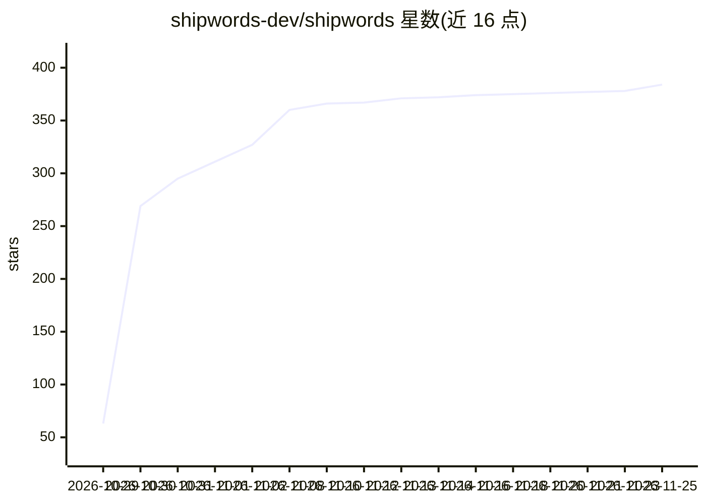

# shipwords-dev/shipwords

⭐ 384 · TypeScript · MIT · 推送 2026-11-23 · [GitHub](https://github.com/shipwords-dev/shipwords) · [官网](https://shipwords.dev) · 组织维护 · 中文 README

**给开发者做新词 AI 站群的 TypeScript 启动框架**

MIT 许可的站群框架：以「一个关键词一个站」的方式批量搭建 AI 图像/视频生成站点，账号、支付、积分与生成逻辑写在共享 core 包，页面、外观与域名按站独立。内置 Google/邮箱登录、Stripe 与 PayPal 计费、访客试用限额、SEO 文件与模板站生成器（pnpm new-site）。自 v0.2.0 起从 Cloudflare Workers 迁移到 Node+Postgres+Docker，每站以独立容器与独立数据库部署。

## 筛选速览

| 维度 | 判定 | 备注 |
|---|---|---|
| AI 角色 | `ai-ecosystem` | LLM/agent 周边工具 |
| 许可风险 | `permissive` | MIT |
| 部署形态 | `self-host` | docker 或自建部署 |
| 模型依赖 | — | README 未给出锁定关系 |
| 硬件要求 | — | 无带数字的原话,不猜 |
| 安装摩擦 | `low` | 无编译、无系统依赖或容器化 |
| 成熟度 | — | 结构信号不足 |

## 能力要点

- pnpm new-site 从模板一键生成完整站点（含支付、登录、SEO 页面）
- 内置 Stripe/PayPal 计费与幂等积分账本，含退款与重复事件处理
- 通过 Yir API 接入 GPT Image、FLUX、Veo、Kling 等生成模型，按次计费
- 本地开发可用 mock 上游，无需模型 key

## 适用场景

- 为新出现的 AI 关键词快速上线付费生成站点
- 用 Claude Code/Cursor 等 coding agent 按模板建站
- 站群中起量的站点继续迭代，其余站点独立停用互不影响

## 场景标签

`视频生成` `图像生成` · 领域:内容生成

## 证据(README 行号)

> L15: shipwords is a free, MIT-licensed framework for running a fleet of new-keyword AI image and video sites on Node, Po
> L42: No keyword yet? new-term-radar, a separate open-source project, catches new AI terms on X, Hugging Face, GitHub and
> L116: Each site is a TanStack Start + React 19 app served by Node in its own Docker container, with its own Postgres dat

## 星数曲线

2026-10-29 63 → 2026-11-25 384（+321）

---
*卡片 v1 · prompt 1.4 · 生成 2026-11-25 · 置信度 mid · 依据 README sha `52804685a4c6` · [字段定义](../../DATASET.md)*
