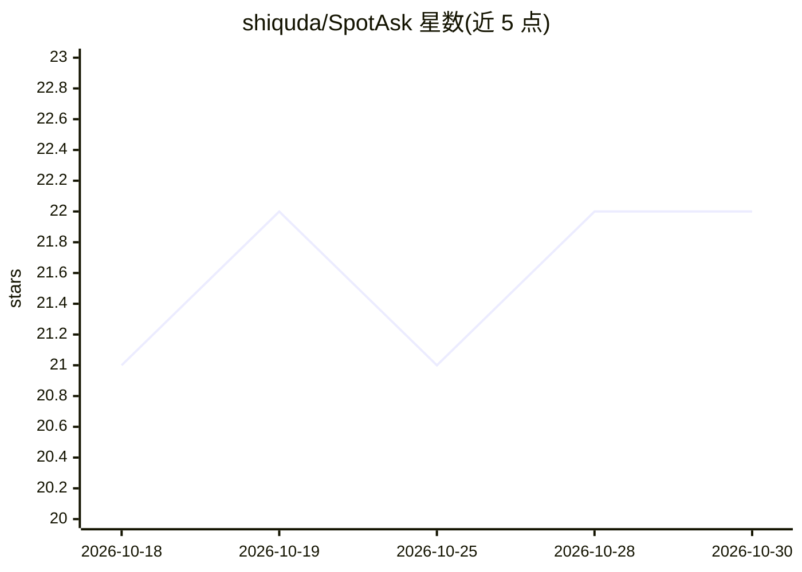

# shiquda/SpotAsk

⭐ 22 · Swift · AGPL-3.0 · 推送 2026-10-28 · [GitHub](https://github.com/shiquda/SpotAsk) · [官网](https://shiquda.github.io/SpotAsk/) · 个人维护 · 中文 README

**macOS 菜单栏 AI 助手：快捷键唤起提问并路由到多端**

原生 Swift 编写的 macOS 菜单栏应用：全局快捷键 ⌥Space 唤起提问窗口，用自有 API key（BYOK）流式获取回答；支持选中文本就地翻译/解释/摘要/润色；可将问题路由到 Web AI（ChatGPT/Perplexity/Grok）、本地 CLI agent 或桌面应用，也可由决策模型（如 jev）自动选择目的地并给置信度。密钥存于 macOS Keychain，声明零遥测、无账号。要求 macOS 15+，通过 DMG、Homebrew cask 或源码构建安装。

## 筛选速览

| 维度 | 判定 | 备注 |
|---|---|---|
| AI 角色 | `ai-native` | 本体是模型或模型工具 |
| 许可风险 | `viral` | AGPL-3.0 |
| 部署形态 | `None` |  |
| 模型依赖 | — | README 未给出锁定关系 |
| 硬件要求 | — | 无带数字的原话,不猜 |
| 安装摩擦 | `low` | 无编译、无系统依赖或容器化 |
| 成熟度 | — | 结构信号不足 |

## 能力要点

- 全局快捷键唤起，BYOK 流式回答
- 选中文本就地翻译/解释/摘要/润色
- 一键或决策模型路由到 Web AI / CLI agent / 桌面应用
- 纯 Swift/AppKit 原生构建，密钥存 Keychain，声明零遥测

## 适用场景

- 在任何应用里快捷键唤起 AI 问答，Esc 即走
- 对选中文字就地翻译、解释或润色
- 把问题分流到 ChatGPT/Perplexity 或本地 CLI agent 以节省 API token

## 场景标签

`AI 助手` · 领域:对话与助手

## 证据(README 行号)

> L3:  A native macOS menu-bar AI assistant & query router. Summon with a hotkey, then answer in-app (BYOK) or route to we
> L28: - **Quick ask** — Press `⌥ + Space` to summon a focused window anywhere, stream an answer with your own API key, an
> L34: - **Instant hotkey capture, dismiss anytime** — Press `⌥ + Space` (customizable) to summon a focused input window a

## 星数曲线

2026-10-18 21 → 2026-10-30 22（+1）

---
*卡片 v1 · prompt 1.4 · 生成 2026-10-28 · 置信度 high · 依据 README sha `72cd85be60d0` · [字段定义](../../DATASET.md)*
