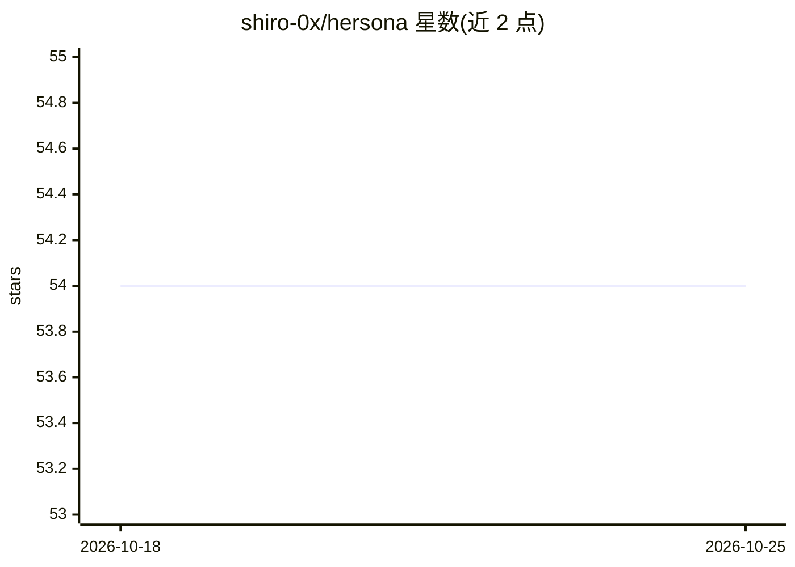

# shiro-0x/hersona

⭐ 54 · Python · MIT · 推送 2026-09-17 · [GitHub](https://github.com/shiro-0x/hersona) · [官网](https://shiro-0x.github.io/hersona/) · 个人维护 · 中文 README

**AI agent 人格模板库：346 个可组合角色属性，一次构建多端移植**

为 LLM/agent 提供 persona 层的 Python 库：内置 346 个带 schema 校验的角色属性（性格/语言风格/原型/外观/爱好），通过 blend 引擎组合并检查属性冲突，支持按权重调节强度；提供确定性基准（无 LLM、无嵌入、可复现）测量人格维持率、衰减曲线、锁定抗性与 token 成本；可导出为 json、markdown、openai_assistants、langchain_system_message、character_card_v3 等格式，或直接写入 AGENTS.md/CLAUDE.md 等各编码 agent 的约定文件；另有 CLI、MCP 服务器与 Hermes Agent skill 形态。自述为 persona 层而非 agent 运行时，不改进推理/检索/工具调用。

## 筛选速览

| 维度 | 判定 | 备注 |
|---|---|---|
| AI 角色 | `ai-ecosystem` | LLM/agent 周边工具 |
| 许可风险 | `permissive` | MIT |
| 部署形态 | `library` | 以包/库形式分发 |
| 模型依赖 | — | README 未给出锁定关系 |
| 硬件要求 | — | 无带数字的原话,不猜 |
| 安装摩擦 | `low` | 无编译、无系统依赖或容器化 |
| 成熟度 | — | 结构信号不足 |

## 能力要点

- 346 个 schema 校验的角色属性，5 大类组织，含兼容/冲突矩阵
- 确定性人格基准 hersona bench（无 LLM、无嵌入、可复现）
- 导出 6 种格式并可写入 AGENTS.md/CLAUDE.md 等 agent 约定文件
- 提供 CLI、MCP 服务器（hersona-mcp）与 Hermes skill 三种接入形态

## 适用场景

- 给我的编码 agent 配置并保持一致的人格设定
- 在多个 LLM/agent 框架间复用同一套 persona
- 测量 persona 在对话中的维持率与 token 成本

## 场景标签

`提示工程` `模型评测` · 领域:Agent 开发

## 证据(README 行号)

> L11: LLM or agent framework. **MIT** (code) + **CC0** (templates). CLI, MCP
> L58: Hersona remains a persona layer, not an agent runtime:
> L154: hersona is a **persona layer**, not an agent framework — it keeps a

## 星数曲线

2026-10-18 54 → 2026-10-25 54（+0）

---
*卡片 v1 · prompt 1.4 · 生成 2026-10-24 · 置信度 high · 依据 README sha `ec52fb014cb3` · [字段定义](../../DATASET.md)*
