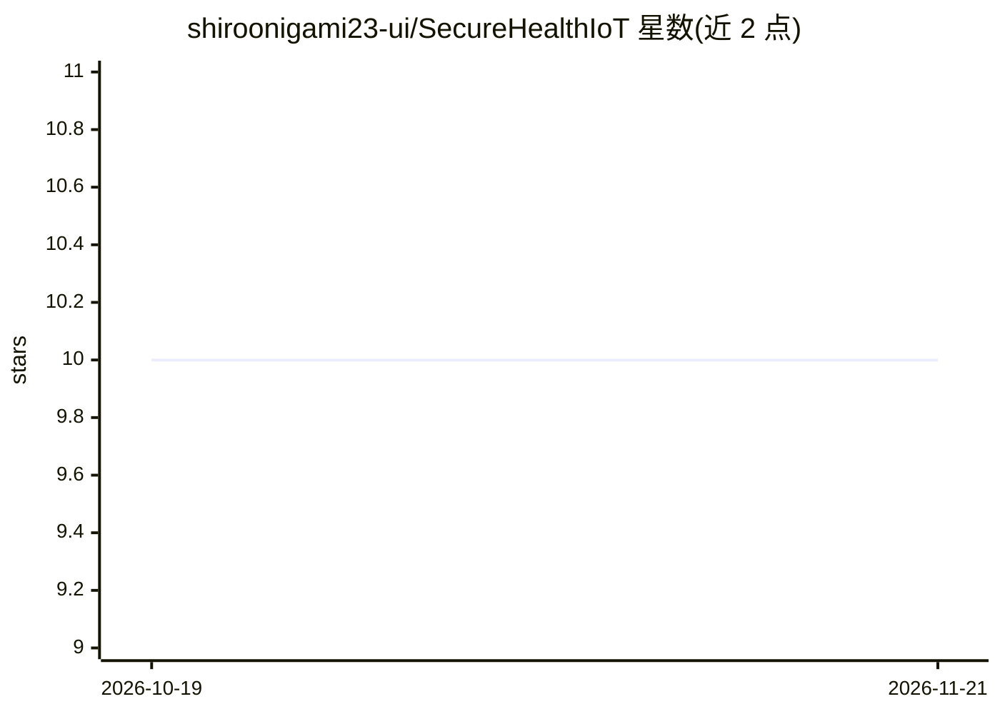

# shiroonigami23-ui/SecureHealthIoT

⭐ 10 · Python · MIT · 推送 2026-11-13 · [GitHub](https://github.com/shiroonigami23-ui/SecureHealthIoT) · [官网](https://huggingface.co/spaces/ShiroOnigami23/securehealthiot-disease-app) · 个人维护

**面向症状到疾病的疾病预测训练与部署流水线（带 Gradio 应用与 Hugging Face 发布）**

基于 Kaggle 数据集的疾病预测项目：按症状签名分组切分以防泄漏，含外部验证集与独立数据集上的 OOD 验证，使用 CalibratedClassifierCV（sigmoid）做概率校准，训练模型登记版本并连同数据集发布到 Hugging Face，配套 Gradio Space。应用提供症状多选的 top-3 预测、可配置阈值的弃权模式、从上传的 TXT/CSV/PDF 报告提取症状的辅助模式，以及面向临床医生的 PDF 导出。README 声明为研究/教育工具，非诊断设备。

## 筛选速览

| 维度 | 判定 | 备注 |
|---|---|---|
| AI 角色 | `ai-native` | 本体是模型或模型工具 |
| 许可风险 | `permissive` | MIT |
| 部署形态 | `self-host` | docker 或自建部署 |
| 模型依赖 | — | README 未给出锁定关系 |
| 硬件要求 | — | 无带数字的原话,不猜 |
| 安装摩擦 | `low` | 无编译、无系统依赖或容器化 |
| 成熟度 | — | 结构信号不足 |

## 能力要点

- 按症状签名分组切分防泄漏 + OOD 外部验证
- sigmoid 概率校准与可配置置信阈值的弃权模式
- 报告辅助分析：从 TXT/CSV/PDF 提取症状并导出临床 PDF
- 模型/数据集/Space 发布到 Hugging Face，含版本化注册表

## 适用场景

- 输入症状获取 top-3 疾病预测与注意事项
- 上传检查报告辅助提取症状并生成临床报告
- 复现带泄漏防护的疾病预测训练流水线

## 场景标签

`模型训练` `文档解析` · 领域:知识与检索

## 证据(README 行号)

> L17: **SecureHealthIoT** predicts likely diseases from symptoms — but with the reliability features that toy notebooks s
> L30: - **OOD validation** on `kaushil268/disease-prediction-using-machine-learning`

## 星数曲线

2026-10-19 10 → 2026-11-21 10（+0）

---
*卡片 v1 · prompt 1.4 · 生成 2026-11-19 · 置信度 high · 依据 README sha `8ec928770e41` · [字段定义](../../DATASET.md)*
