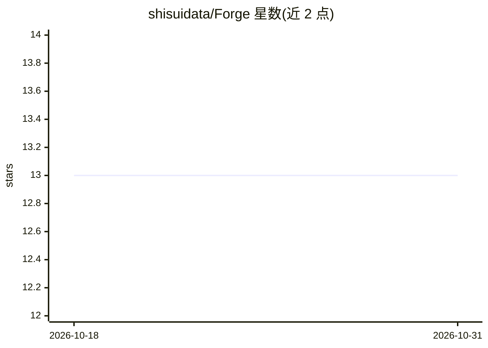

# shisuidata/Forge

⭐ 13 · Python · Apache-2.0 · 推送 2026-10-28 · [GitHub](https://github.com/shisuidata/Forge) · 组织维护 · 中文 README

**面向 AI 数据查询的可信中间层基础设施：受约束候选、确定性 SQL 编译、可审查执行**

Forge 位于上游 agent 与数据库之间：接收 Direct SQL 或受约束的 Forge JSON 候选，经 Registry 语义层、确定性 SQL 编译、只读与范围检查、人工审查、Evidence 与 Audit 后执行。LLM 只负责生成 Forge JSON（结构化输出），编译器负责 JSON→SQL 翻译，用户审查的 SQL 即实际执行的 SQL。提供 Evaluate/Enforce/Explain 等 API 与 CLI，支持 SQLite/PostgreSQL/MySQL 方言，内置两档 schema 检索器（RAG）。项目自述为早期阶段，不声明开放式 100% 准确率，真实生产环境与独立安全审计尚未验证。

## 筛选速览

| 维度 | 判定 | 备注 |
|---|---|---|
| AI 角色 | `ai-ecosystem` | LLM/agent 周边工具 |
| 许可风险 | `permissive` | Apache-2.0 |
| 部署形态 | `library` | 以包/库形式分发 |
| 模型依赖 | — | README 未给出锁定关系 |
| 硬件要求 | — | 无带数字的原话,不猜 |
| 安装摩擦 | `low` | 无编译、无系统依赖或容器化 |
| 成熟度 | `idea` | |

## 能力要点

- Forge JSON 中间表示 + 确定性 SQL 编译（同输入同输出）
- QueryRun 审查流、只读 SQL、表/列范围、审批哈希、超时与结果上限
- Enforce 治理 API：管理员签发可撤销 Mandate 约束 agent 的任务/数据源/表集
- 版本化 Evaluate API/CLI（持久套件、回放、回归门禁）与 SQLGlot AST 别名扩展

## 适用场景

- 在 AI 数据问答链路中加入人工审查与只读执行闸门
- 跨团队统一指标语义（Registry 语义层）并使执行可审计
- 对 Text-to-SQL 候选做可回放评测与回归验证

## 场景标签

`数据分析` `模型评测` · 领域:效率与自动化

## 证据(README 行号)

> L8: Forge sits between an upstream agent and a database. It accepts Direct SQL or constrained Forge JSON candidates, the
> L25: - versioned, non-executing Evaluate API/CLI with persistent suites, manifests, replay, and regression gates;

## 星数曲线

2026-10-18 13 → 2026-10-31 13（+0）

---
*卡片 v1 · prompt 1.4 · 生成 2026-10-31 · 置信度 high · 依据 README sha `0e5e2e2d34fa` · [字段定义](../../DATASET.md)*
