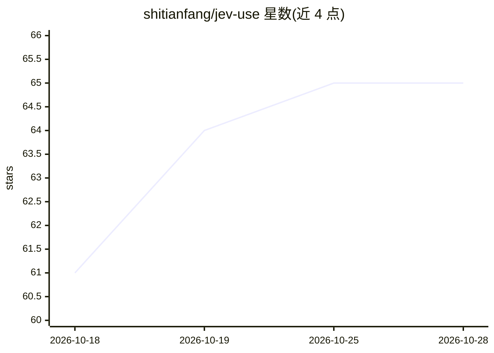

# shitianfang/jev-use

⭐ 65 · JavaScript · MIT · 推送 2026-09-22 · [GitHub](https://github.com/shitianfang/jev-use) · [官网](https://www.npmjs.com/package/jev-use) · 个人维护 · 中文 README

**让 Claude Code/Codex/pi 把无需文本输出的步骤交给 Jev 判决模型的插件**

面向 Claude Code、Codex 与 pi 的插件与 npm 库：将不需要生成文本的 agent 步骤（判断/选择/评分/命令门控）路由到 Jev 判决模型执行，文本内容仍交回 LLM；超出能力范围时以 escalate:true 加类型化原因回退。通过 npx 安装并自动接线宿主，另提供 MCP 工具与 PreToolUse 门控钩子，支持 TypeSafe/OpenRouter/Vercel AI Gateway 及 mock 无 key 模式，发送前剥离凭据。README 附可复跑基准脚本与第三方测量文档。

## 筛选速览

| 维度 | 判定 | 备注 |
|---|---|---|
| AI 角色 | `ai-ecosystem` | LLM/agent 周边工具 |
| 许可风险 | `permissive` | MIT |
| 部署形态 | `library` | 以包/库形式分发 |
| 模型依赖 | locked-api |  |
| 硬件要求 | — | 无带数字的原话,不猜 |
| 安装摩擦 | `low` | 无编译、无系统依赖或容器化 |
| 成熟度 | — | 结构信号不足 |

## 能力要点

- 将判断/选择/评分类步骤路由给 Jev，不确定项类型化回退 LLM
- MCP 工具两个 + PreToolUse shell 命令门控（危险命令拒绝并给理由）
- 支持 TypeSafe/OpenRouter/Vercel AI Gateway 后端与 JEV_BACKEND=mock 本地模式
- npx 一条命令接线已安装的宿主，doctor 检查接线

## 适用场景

- 给 Claude Code/Codex/pi 加装快速决策通道降低 token 消耗
- 对 shell 命令做毫秒级门控拦截危险操作
- 在 agent 中做上下文压缩时的保留/丢弃判定

## 场景标签

`Agent 框架` · 领域:Agent 开发

## 证据(README 行号)

> L5: The best way for Claude Code, Codex, and pi
> L30: npx -y jev-use install    # wires Claude Code, Codex, and pi — whichever it finds
> L73: |src/server.ts|The two MCP tools|

## 星数曲线

2026-10-18 61 → 2026-10-28 65（+4）

---
*卡片 v1 · prompt 1.4 · 生成 2026-10-24 · 置信度 high · 依据 README sha `2edb602ae11a` · [字段定义](../../DATASET.md)*
