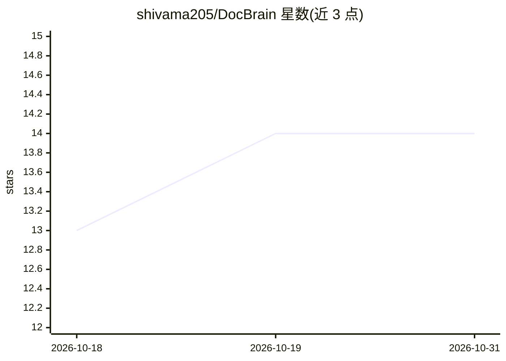

# shivama205/DocBrain

⭐ 14 · Python · MIT · 推送 2026-06-01 · [GitHub](https://github.com/shivama205/DocBrain) · 个人维护

**自托管 RAG 平台：带 RBAC 与自然语言查表（SQL 生成）**

面向不能将数据发送第三方 API 的团队的自托管 RAG 系统：Docker Compose 一键启动 API 服务、Celery worker、MySQL、Redis、ChromaDB 与 React 前端，用户仅需提供 LLM API key。支持上传 PDF/DOCX/TXT/Markdown/HTML 做带引用问答，上传 CSV/Excel 后用自然语言生成 SQL 并执行返回结果；查询路由自动在 RAG 与 TAG 间分流。内置三级 RBAC（User/Owner/Admin）与知识库细粒度共享。多 LLM 支持 Gemini/OpenAI/Anthropic，向量库默认 ChromaDB、可选 Pinecone。

## 筛选速览

| 维度 | 判定 | 备注 |
|---|---|---|
| AI 角色 | `ai-native` | 本体是模型或模型工具 |
| 许可风险 | `permissive` | MIT |
| 部署形态 | `self-host` | docker 或自建部署 |
| 模型依赖 | — | README 未给出锁定关系 |
| 硬件要求 | — | 无带数字的原话,不猜 |
| 安装摩擦 | `low` | 无编译、无系统依赖或容器化 |
| 成熟度 | — | 结构信号不足 |

## 能力要点

- 自然语言查询 CSV/Excel，自动生成并执行 SQL 返回结果
- 三级 RBAC（User/Owner/Admin）与知识库细粒度共享
- ChromaDB 本地向量库，向量数据不出自有基础设施
- 查询路由按内容类型在 RAG 与 TAG 之间分流

## 适用场景

- 团队在自有服务器上搭建私有文档问答系统
- 对表格数据用自然语言提问并获得 SQL 生成的结果
- 按角色和权限在成员间共享知识库

## 场景标签

`文档问答` `数据分析` · 领域:效率与自动化

## 证据(README 行号)

> L5: Self-hosted RAG for teams that can't send data to third-party APIs. Built-in RBAC, multi-LLM support, and natural la
> L40: |**Document RAG**|Upload PDFs, DOCX, TXT, Markdown, HTML -- ask questions, get cited answers|
> L41: |**Table-Augmented Generation**|Upload CSVs/Excel -- ask questions in plain English, get SQL-generated results|

## 星数曲线

2026-10-18 13 → 2026-10-31 14（+1）

---
*卡片 v1 · prompt 1.4 · 生成 2026-10-31 · 置信度 mid · 依据 README sha `2f3e4d89e805` · [字段定义](../../DATASET.md)*
