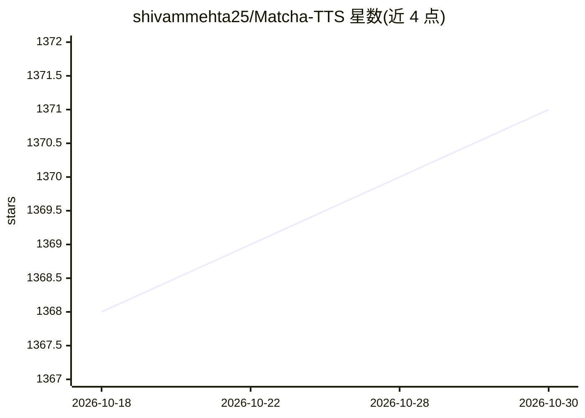

# shivammehta25/Matcha-TTS

⭐ 1,371 · Jupyter Notebook · MIT · 推送 2026-10-19 · [GitHub](https://github.com/shivammehta25/Matcha-TTS) · [官网](https://shivammehta25.github.io/Matcha-TTS/) · 个人维护

**基于条件流匹配的非自回归神经 TTS 模型官方实现**

ICASSP 2024 论文 Matcha-TTS 的官方 PyTorch 实现：非自回归 TTS 架构，用条件流匹配（类似整流流）加速基于 ODE 的语音合成，方法具有概率性、内存占用紧凑、合成速度快。提供 CLI、Gradio 界面与 Jupyter notebook 三种合成方式，预训练模型自动下载；支持在 LJ Speech 等自有数据集上训练，可提取音素级对齐，并支持 ONNX 导出与推理（GPU 需 onnxruntime-gpu）。

## 筛选速览

| 维度 | 判定 | 备注 |
|---|---|---|
| AI 角色 | `ai-native` | 本体是模型或模型工具 |
| 许可风险 | `permissive` | MIT |
| 部署形态 | `library` | 以包/库形式分发 |
| 模型依赖 | — | README 未给出锁定关系 |
| 硬件要求 | — | 无带数字的原话,不猜 |
| 安装摩擦 | `low` | 无编译、无系统依赖或容器化 |
| 成熟度 | — | 结构信号不足 |

## 能力要点

- 非自回归 TTS，条件流匹配加速 ODE 语音合成
- CLI / Gradio / notebook 三种合成入口，预训练模型自动下载
- 支持自有数据集训练、多 GPU 训练与音素对齐提取
- ONNX 导出与推理（可内嵌 vocoder，支持 GPU）

## 适用场景

- 用命令行或界面从文本直接合成语音
- 在自己的语音数据集上训练 TTS 模型
- 导出 ONNX 图在 CPU/GPU 上做推理部署

## 场景标签

`语音合成` `模型训练` · 领域:内容生成

## 证据(README 行号)

> L13: > This is the official code implementation of 🍵 Matcha-TTS [ICASSP 2024].
> L15: We propose 🍵 Matcha-TTS, a new approach to non-autoregressive neural TTS, that uses conditional flow matching (simi
> L59: matcha-tts --text "<INPUT TEXT>"

## 星数曲线

2026-10-18 1,368 → 2026-10-30 1,371（+3）

---
*卡片 v1 · prompt 1.4 · 生成 2026-10-21 · 置信度 high · 依据 README sha `2cc190436f8a` · [字段定义](../../DATASET.md)*
