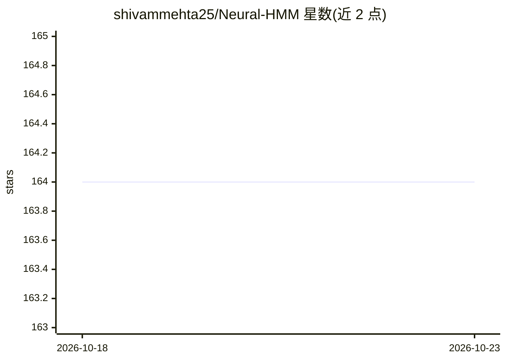

# shivammehta25/Neural-HMM

⭐ 164 · Jupyter Notebook · MIT · 推送 2026-10-19 · [GitHub](https://github.com/shivammehta25/Neural-HMM) · 组织维护

**神经 HMM 文本转语音模型的论文官方实现**

ICASSP 2022 论文 Neural HMMs are all you need (for high-quality attention-free TTS) 的官方 PyTorch 代码库，实现基于隐马尔可夫模型的无注意力 TTS。面向语音合成研究者：提供在 LJ Speech / RyanSpeech 数据集上的训练与合成流程（含预训练男女声模型与 HiFi-GAN 声码器配合），支持多 GPU、混合精度与梯度检查点分支，推荐通过 Docker 运行，代码基于 Nvidia Tacotron 2 实现并用 PyTorch Lightning 构建。

## 筛选速览

| 维度 | 判定 | 备注 |
|---|---|---|
| AI 角色 | `ai-native` | 本体是模型或模型工具 |
| 许可风险 | `permissive` | MIT |
| 部署形态 | `self-host` | docker 或自建部署 |
| 模型依赖 | — | README 未给出锁定关系 |
| 硬件要求 | — | 无带数字的原话,不猜 |
| 安装摩擦 | `low` | 无编译、无系统依赖或容器化 |
| 成熟度 | — | 结构信号不足 |

## 能力要点

- 基于神经 HMM 的无注意力 TTS 模型训练与合成代码
- 提供 LJ Speech（女声）与 RyanSpeech（男声）预训练模型
- 配合 HiFi-GAN 声码器进行波形合成
- 支持多 GPU 训练、混合精度与 gradient_checkpointing 分支

## 适用场景

- 复现论文并训练自己的 TTS 模型
- 用预训练模型直接合成语音
- 在神经 HMM 方法基础上开展 TTS 研究

## 场景标签

`语音合成` · 领域:内容生成

## 证据(README 行号)

> L4: This is the official code repository for the paper "[Neural HMMs are all you need (for high-quality attention-free T
> L23: 8. Run ```python train.py``` to train the model.

## 星数曲线



2026-10-18 164 → 2026-10-23 164（+0）


---
*卡片 v1 · prompt 1.4 · 生成 2026-10-22 · 置信度 mid · 依据 README sha `746a64023a89` · [字段定义](../../DATASET.md)*
