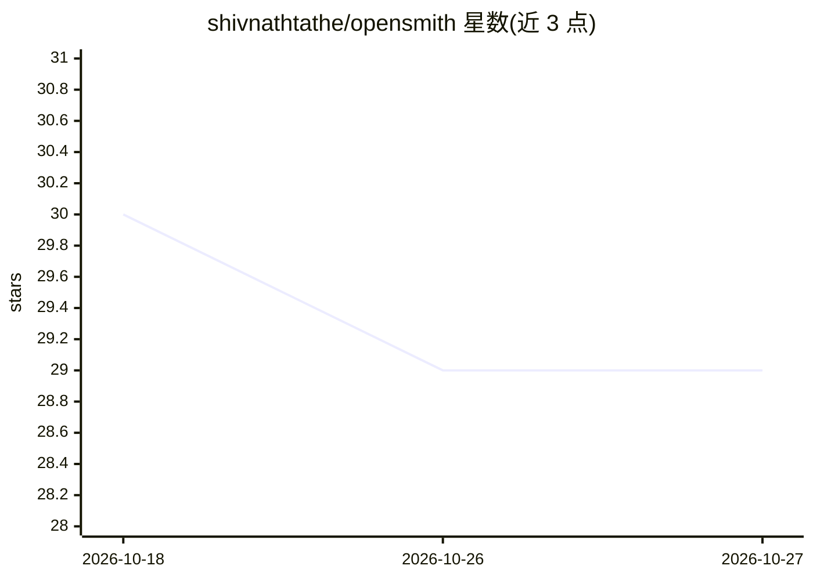

# shivnathtathe/opensmith

⭐ 29 · Python · MIT · 推送 2026-07-26 · [GitHub](https://github.com/shivnathtathe/opensmith) · [官网](https://shivnathtathe.com) · 个人维护

**本地优先的 LLM 追踪观测工具：LangSmith 的开源替代**

面向 Python LLM 应用的本地追踪与观测库：通过 @trace 装饰器、上下文管理器或 autopatch() 零代码侵入方式追踪任意 Python LLM 流水线，支持 openai/anthropic/litellm 及 qdrant/chromadb/pinecone 等后端的自动打点。追踪数据默认存本地 SQLite（~/.opensmith/traces.db），可选 Postgres 存储；提供 opensmith ui 本地面板（localhost:7823）、CLI 过滤/统计/导出（JSON/CSV）、token 预算告警与 OpenTelemetry 可选导出。自称 LangSmith 的本地替代，不依赖云账号与 Docker。

## 筛选速览

| 维度 | 判定 | 备注 |
|---|---|---|
| AI 角色 | `ai-ecosystem` | LLM/agent 周边工具 |
| 许可风险 | `permissive` | MIT |
| 部署形态 | `library` | 以包/库形式分发 |
| 模型依赖 | — | README 未给出锁定关系 |
| 硬件要求 | — | 无带数字的原话,不猜 |
| 安装摩擦 | `low` | 无编译、无系统依赖或容器化 |
| 成熟度 | — | 结构信号不足 |

## 能力要点

- @trace / 上下文管理器 / autopatch() 三种接入方式，autopatch 可零代码改动
- 追踪数据 100% 本地存储，默认 SQLite，可选 Postgres
- 内置本地面板 opensmith ui 与 CLI（过滤、统计、JSON/CSV 导出）
- 支持 openai/anthropic/litellm 等后端自动打点，OpenTelemetry 可选导出

## 适用场景

- 本地查看与调试 LLM/RAG 流水线的调用追踪
- 不将追踪数据上传云端的前提下做 LLM 观测
- 统计 trace/step/token/cost 聚合指标并导出分析

## 场景标签

`LLM 可观测性` · 领域:评测与运维

## 证据(README 行号)

> L13: The open-source, local-first alternative to LangSmith.
> L31: LangSmith is powerful, but it is built around cloud-hosted tracing and is most natural inside the LangChain ecosyst
> L158: ## Supported backends

## 星数曲线

2026-10-18 30 → 2026-10-27 29（-1）

---
*卡片 v1 · prompt 1.4 · 生成 2026-10-26 · 置信度 high · 依据 README sha `6ac29275efe0` · [字段定义](../../DATASET.md)*
