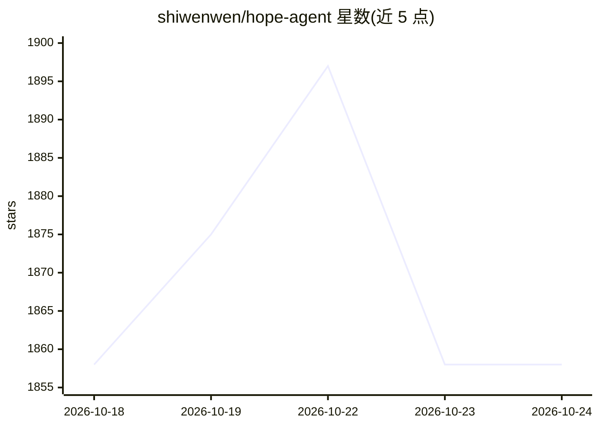

# shiwenwen/hope-agent

⭐ 1,859 · Rust · MIT · 推送 2026-10-24 · [GitHub](https://github.com/shiwenwen/hope-agent) · 个人维护 · 中文 README

**跨设备桌面个人 AI agent：记忆、自主目标与动态工作流**

基于 Rust/Tauri/React 的本地优先桌面 AI 助手，macOS 完整支持，Linux/Windows 为实验性，也可在 NAS/云端以服务化方式常驻运行。核心机制：Goal 定义目标、Workflow 动态编排（含多 Agent、并行、验证）、Loop 定时或事件驱动推进、跨会话分层记忆与闲置时整理；提供 Design Space 生成 10+ 类产物、Knowledge Space 共同读写 Markdown 笔记、MCP 客户端与 Hooks、计算机/浏览器控制（需授权）、Docker 沙箱，会话可在桌面/浏览器/IM（Telegram、Discord、Slack、飞书等）之间交接；支持 Ollama 一键本地模型。

## 筛选速览

| 维度 | 判定 | 备注 |
|---|---|---|
| AI 角色 | `ai-native` | 本体是模型或模型工具 |
| 许可风险 | `permissive` | MIT |
| 部署形态 | `desktop` | 安装包/桌面程序 |
| 模型依赖 | local-ok | 支持本地模型 |
| 硬件要求 | — | 无带数字的原话,不猜 |
| 安装摩擦 | `low` | 无编译、无系统依赖或容器化 |
| 成熟度 | `idea` | |

## 能力要点

- Goal/Workflow/Loop/Task/Mode 组合实现后台持续推进的长期任务
- 跨会话持久记忆（Global/Project/Agent 三层）与闲置时整理、Dream Diary
- 会话在桌面、浏览器与 IM 渠道间交接，单实例保持记忆与任务状态
- 一键安装 Ollama 本地模型（含本地 embedding），无需账号或终端

## 适用场景

- 在桌面工作区讨论、检视仓库、改文件并运行检查
- 在 NAS 上常驻一个实例，通过浏览器或 IM 随时接入继续任务
- 把资料组织进 Knowledge Space，让 AI 基于笔记持续产出草稿

## 场景标签

`AI 助手` `多智能体` `工作流自动化` `知识库管理` · 领域:Agent 开发

## 证据(README 行号)

> L36: **Hope Agent** is a local-first, desktop-first personal AI agent that can also run continuously as a service. It op
> L86:  🎯 Goal · keep pursuing the outcome Give Hope Agent an outcome and completion criteria, and it keeps decomposing, e
> L117:  🖥️ Native GUI and model setup macOS provides the complete desktop experience, while Linux and Windows support is 

## 星数曲线

2026-10-18 1,858 → 2026-10-24 1,858（+0）

---
*卡片 v1 · prompt 1.4 · 生成 2026-10-21 · 置信度 mid · 依据 README sha `604cb4079b8c` · [字段定义](../../DATASET.md)*
