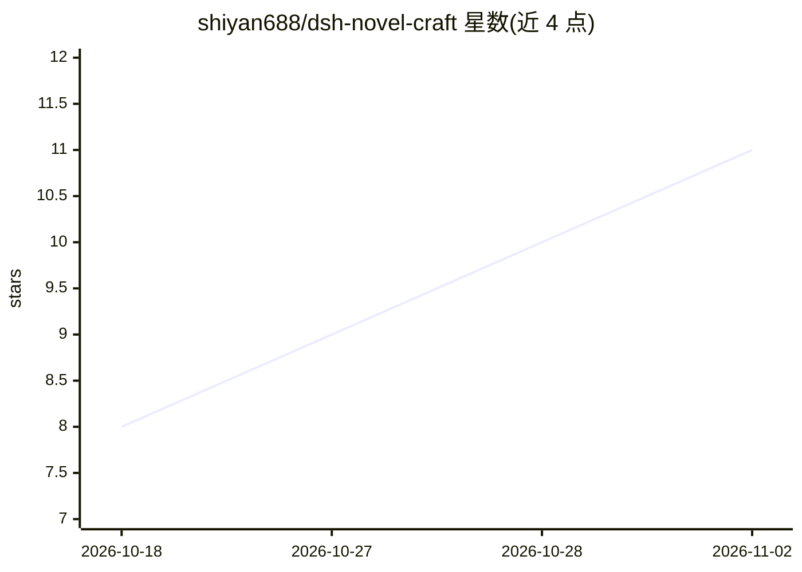

# shiyan688/dsh-novel-craft

⭐ 11 · JavaScript · MIT · 推送 2026-10-23 · [GitHub](https://github.com/shiyan688/dsh-novel-craft) · [官网](https://www.npmjs.com/package/dsh-novel-craft) · 个人维护 · 中文 README

**给中文小说作者的 AI 写作插件：点赞点踩校准个人文风**

跑在 DeepSeek Harness（dsh）上的 MIT 开源插件（MIT 协议声明见仓库描述与 L5），面向中文网文/长篇小说作者。核心机制是偏好校准：作者读候选稿时点赞/点踩，插件把这批点选交给一次辅助模型调用提炼成写作规律（几百字节的偏好档案），下一轮写稿的写作包自动携带。支持章节管理、多方向候选稿生成、按批注局部微调、情节体检（张力曲线/伏笔欠账等本地统计）。写稿时正文不进上下文，仅三个手动按钮触发带原文的调用且各有字数上限。需 Node 22 与自备 dsh 模型额度。

## 筛选速览

| 维度 | 判定 | 备注 |
|---|---|---|
| AI 角色 | `ai-native` | 本体是模型或模型工具 |
| 许可风险 | `permissive` | MIT |
| 部署形态 | `library` | 以包/库形式分发 |
| 模型依赖 | locked-api |  |
| 硬件要求 | — | 无带数字的原话,不猜 |
| 安装摩擦 | `low` | 无编译、无系统依赖或容器化 |
| 成熟度 | `idea` | |

## 能力要点

- 点赞/点踩 → 模型提炼写作规律 → 写稿时自动携带偏好档案
- 写作包机制：写稿上下文仅含规律+前情设定，默认 9000 字预算，正文不进模型
- 按批注微调仅改被标注段落，改后逐字核对、不符拒绝写回
- 775 条断言 / 7 个测试文件，兼容性脚本可自证 dsh 各版本适配

## 适用场景

- 长篇连载作者让 AI 候选稿逐步贴近自己的文风
- 多方向候选稿生成、抽卡选段与合并定稿的章节流程
- 长篇写作中的伏笔、张力与大纲偏移检查

## 场景标签

 · 领域:创意写作/中文小说

## 证据(README 行号)

> L5: **dsh-novel-craft 是一个跑在 DeepSeek Harness（dsh）上的开源 AI 小说写作插件**（MIT 协议，npm 一行安装）。它解决的是「怎么让 AI 写出符合你个人文风的小说」——不用反复调提示词，
> L11: 读候选稿时顺手点一下——好段落 👍、坏段落 👎。然后让模型把这批点选总结成几条能照着做的写法，写进一份档案。下一轮写稿带着这份档案，写完再点、再总结。它总结出来的东西长这样（我自己的档案）：
> L183: 一个跑在 DeepSeek Harness（dsh）上的开源 AI 小说写作插件，MIT 协议。核心能力是「偏好校准」：你读候选稿时点 👍/👎，模型把你的点选提炼成几条写作规律，下一轮写稿自动带上，越用越接近你的口味。

## 星数曲线

2026-10-18 8 → 2026-11-02 11（+3）

---
*卡片 v1 · prompt 1.4 · 生成 2026-11-02 · 置信度 high · 依据 README sha `d93e2eded412` · [字段定义](../../DATASET.md)*
