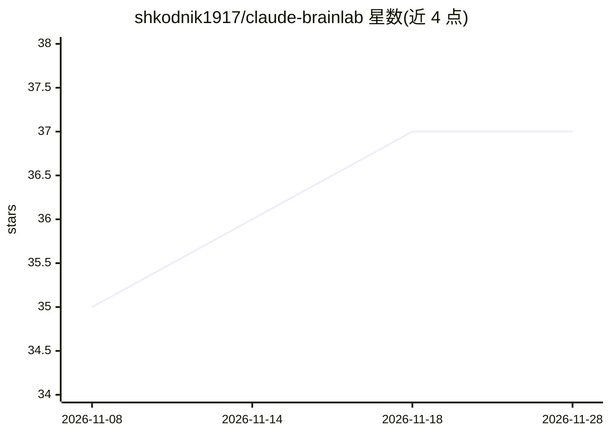

# shkodnik1917/claude-brainlab

⭐ 37 · Python · MIT · 推送 2026-11-10 · [GitHub](https://github.com/shkodnik1917/claude-brainlab) · [官网](https://vepricov.github.io/claude-brainlab/lab-showcase/) · 组织维护

**科研实验室的 Claude Code 配置包：67 个技能加 git 知识库**

BRAIn Lab 的可复用工作台配置：面向 Claude Code 的 67 个技能、13 个 agent、9 个 hooks、11 条规则与 10 个斜杠命令，覆盖文献摄取（arXiv→Zotero→Obsidian）、实验记录、论文写作与评审八阶段研究循环。知识库是普通 git：一个 GitLab 群组中每个研究工作一个仓库，同时作为 Obsidian vault，变更须经人工合并的 merge request 进入，历史知识服务已于 2026-07-10 移除，现以 git+grep 读取。提供 bootstrap/setup 脚本安装到 ~/.claude/，可选依赖 Obsidian、Zotero、MemPalace，无 GitLab 访问也可安装运行。

## 筛选速览

| 维度 | 判定 | 备注 |
|---|---|---|
| AI 角色 | `ai-ecosystem` | LLM/agent 周边工具 |
| 许可风险 | `permissive` | MIT |
| 部署形态 | `None` |  |
| 模型依赖 | locked-api |  |
| 硬件要求 | — | 无带数字的原话,不猜 |
| 安装摩擦 | `low` | 无编译、无系统依赖或容器化 |
| 成熟度 | — | 结构信号不足 |

## 能力要点

- 67 个技能覆盖文献、实验、写作、评审等研究环节
- 知识库为纯 git：合并请求+人工合并写入，单文件树同时是 Obsidian vault
- paper-ingest 流水线：arXiv URL→外部 API 取 BibTeX→Zotero→Obsidian 笔记
- 通过 bootstrap/setup 脚本安装，提供卸载回滚脚本

## 适用场景

- 科研团队为 Claude Code 部署成套研究工作流配置
- 以 git 仓库形式管理研究声明、实验记录与文献笔记
- 把论文摄取、评审与社交化发布流程自动化

## 场景标签

`科研工具` `知识库管理` · 领域:知识与检索

## 证据(README 行号)

> L5:  The working setup of BRAIn Lab: Claude Code skills, hooks and rules
> L26: The repository is the lab's own configuration, packaged so another lab can install it. Claude Code
> L95: |**Skills**|67|the working units: literature, experiments, Obsidian, code, writing, review|`skills/`|

## 星数曲线

2026-11-08 35 → 2026-11-28 37（+2）

---
*卡片 v1 · prompt 1.4 · 生成 2026-11-18 · 置信度 high · 依据 README sha `c62b7b30bef3` · [字段定义](../../DATASET.md)*
