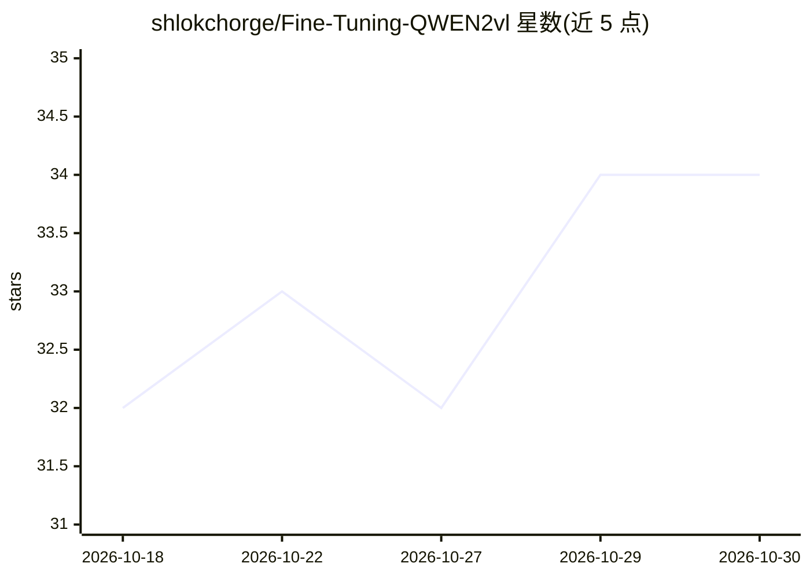

# shlokchorge/Fine-Tuning-QWEN2vl

⭐ 34 · Jupyter Notebook · 推送 2026-06-25 · [GitHub](https://github.com/shlokchorge/Fine-Tuning-QWEN2vl) · [官网](https://huggingface.co/spaces/shlokchorge2929/visiontex) · 个人维护

**微调 Qwen2-VL-7B 实现数学表达式图像转 LaTeX**

VisionTeX 是在 LaTeX OCR 数据集上用 Unsloth 与 LoRA 微调 Qwen2-VL-7B-Instruct 得到的数学表达式识别系统：输入公式图像，输出可编译还原的 LaTeX 源码。项目覆盖完整流程——训练笔记本、数据增强管线（旋转/噪声/对比度抖动/模糊）、LoRA rank 扫描（r=8/16/32）、四项指标评估（CER/Token F1/BLEU-4/Exact Match），以及 Gradio 在线演示。以 LoRA 适配器（数百 MB）与合并后完整检查点两种形式发布模型。当前为 T4 上 500 步的部分训练版本。

## 筛选速览

| 维度 | 判定 | 备注 |
|---|---|---|
| AI 角色 | `ai-native` | 本体是模型或模型工具 |
| 许可风险 | `none` | — |
| 部署形态 | `library` | 以包/库形式分发 |
| 模型依赖 | — | README 未给出锁定关系 |
| 硬件要求 | `gpu-8g` | |
| 安装摩擦 | `low` | 无编译、无系统依赖或容器化 |
| 成熟度 | `idea` | |

## 能力要点

- LoRA rank 扫描（r=8/16/32）与学习率调度器对比量化
- 四指标评估：CER、Token F1、BLEU-4、Exact Match
- 发布两种检查点：LoRA 适配器与合并后完整权重
- 4-bit 量化可将显存需求从约 14GB 降至 5-6GB

## 适用场景

- 把论文、教材、扫描件中的公式数字化为 LaTeX
- 复现或扩展视觉语言模型的 LaTeX OCR 微调实验
- 通过 HuggingFace Space 在线上传图片即时生成 LaTeX

## 场景标签

`微调` `OCR` · 领域:感知与多模态

## 证据(README 行号)

> L3: VisionTeX is a mathematical expression recognition system built by fine-tuning Qwen2-VL-7B-Instruct on the LaTeX OCR
> L12: The model takes an image containing mathematical notation and outputs LaTeX markup that, when compiled, reproduces 

## 星数曲线

2026-10-18 32 → 2026-10-30 34（+2）

---
*卡片 v1 · prompt 1.4 · 生成 2026-10-25 · 置信度 mid · 依据 README sha `6e73abf6164b` · [字段定义](../../DATASET.md)*
