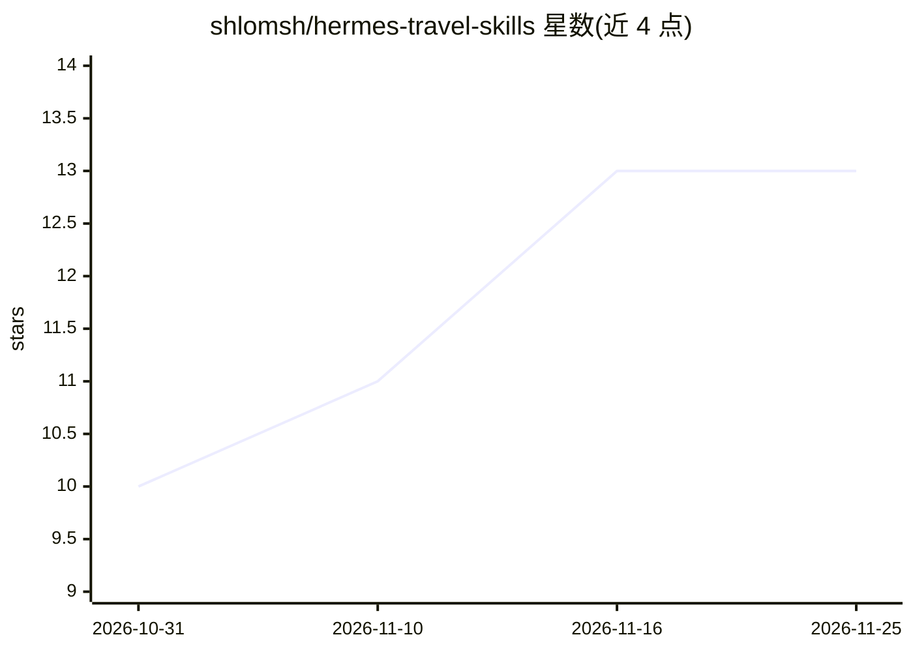

# shlomsh/hermes-travel-skills

⭐ 13 · Python · MIT · 推送 2026-06-02 · [GitHub](https://github.com/shlomsh/hermes-travel-skills) · 个人维护

**为 Hermes Agent 提供实时旅行查询技能的 Python 工具包**

面向 Nous Research Hermes Agent 的三个旅行类技能包：Google Places 地点搜索、Google Weather 实时天气、aviationstack 航班状态（登机口/航站楼/延误/行李转盘）。每个技能为一个 SKILL.md 加单个 Python 脚本，仅用标准库、零 pip 依赖，MIT 许可；脚本可脱离 Hermes 作为独立 CLI 运行，也可通过 git clone 复制到 agent 的 skills 目录使用，需自备三个 API key。

## 筛选速览

| 维度 | 判定 | 备注 |
|---|---|---|
| AI 角色 | `ai-ecosystem` | LLM/agent 周边工具 |
| 许可风险 | `permissive` | MIT |
| 部署形态 | `library` | 以包/库形式分发 |
| 模型依赖 | — | README 未给出锁定关系 |
| 硬件要求 | — | 无带数字的原话,不猜 |
| 安装摩擦 | `low` | 无编译、无系统依赖或容器化 |
| 成熟度 | — | 结构信号不足 |

## 能力要点

- 三个 API 支持的技能：地点搜索、实时天气、航班状态查询
- 零 pip 依赖，脚本仅用 Python 标准库
- 可脱离 Hermes 作为独立 CLI 运行，也可接入其他 agent 框架或 MCP 式工具设置

## 适用场景

- 让 AI agent 用自然语言查询航班登机口、延误和行李转盘
- 通过 agent 查找附近当前营业的高评分餐厅和咖啡馆
- 出行前询问目的地实时天气决定穿衣打包

## 场景标签

 · 领域:AI agent 工具/旅行

## 证据(README 行号)

> L11: **Hermes Travel Skills** is an open-source pack of real-time travel tools (skills) for the Nous Research **Hermes A
> L148: These are Hermes Agent skills. A skill is just a folder (`SKILL.md` + script) placed under your agent's skills dir

## 星数曲线

2026-10-31 10 → 2026-11-25 13（+3）

---
*卡片 v1 · prompt 1.4 · 生成 2026-11-18 · 置信度 mid · 依据 README sha `543e15ce0ab8` · [字段定义](../../DATASET.md)*
